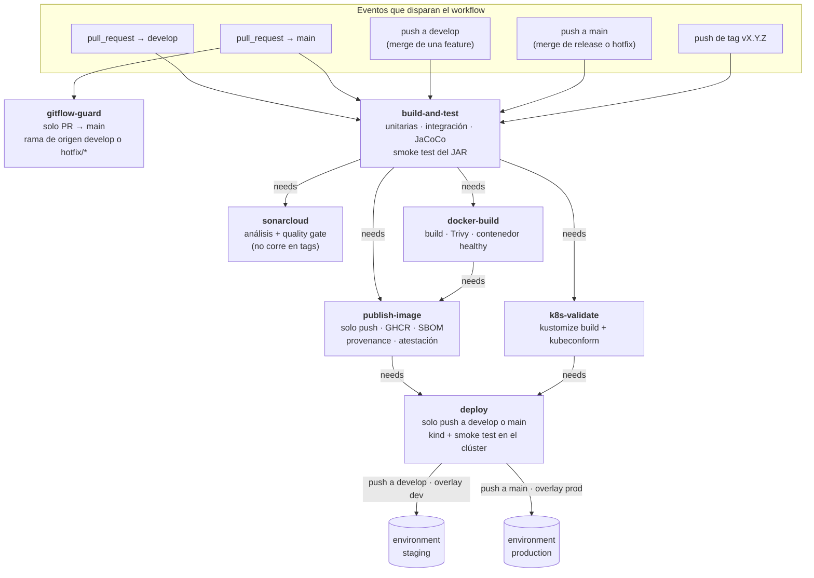
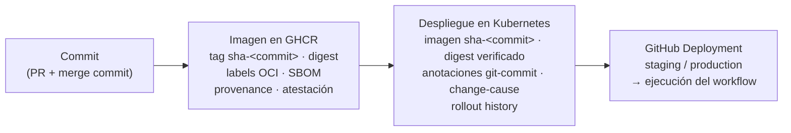

# charmeetchic-api

[](https://github.com/DGomezPalacios/charmeetchic_api/actions/workflows/ci.yml)
[](https://sonarcloud.io/summary/new_code?id=DGomezPalacios_charmeetchic_api)
[](https://sonarcloud.io/summary/new_code?id=DGomezPalacios_charmeetchic_api)

API REST para el **control de inventario** de la tienda de accesorios y joyas **Charme et Chic**, diseñada para
crecer hacia un ecommerce (carrito, checkout, pagos).

- **Stack:** Java 17 · Spring Boot 3.5 · Spring Security · Spring Data JPA · JWT · Maven
- **Base de datos:** H2 en memoria (desarrollo y tests) · PostgreSQL 17 en Kubernetes (perfil `k8s`)
- **Contenedores y despliegue:** Docker (imagen multi-etapa publicada en GHCR) · Kubernetes con Kustomize · kind
- **CI/CD:** GitHub Actions · JaCoCo · SonarCloud · Trivy · Dependabot
- **Autenticación:** **Firebase Authentication**. La API valida los *ID tokens* de Firebase (firma RS256 con las claves
  públicas de Google, emisor, audiencia, `sub` y expiración)
- **Autorización:** roles `ADMIN` y `USER` (custom claims de Firebase)
- **URL base:** `http://localhost:8080/api`

---

## DevOps

Proyecto **individual**: el desarrollo, la revisión de los PR y la gestión del repositorio los realiza una sola persona,
siguiendo GitFlow con PR obligatorios y CI/CD en GitHub Actions. El pipeline completo se describe más abajo, en
[Pipeline CI/CD (Evaluación 2)](#pipeline-cicd-evaluación-2).

- [CONTRIBUTING.md](CONTRIBUTING.md): modelo de ramas, naming, convención de commits, flujo de merge, versionado,
  estrategia de revisión, política de calidad y de seguridad.
- [docs/workflow.md](docs/workflow.md): diagramas del flujo GitFlow y del pipeline de CI/CD, y qué job corre en cada
  evento.
- [docs/kubernetes.md](docs/kubernetes.md): arquitectura en Kubernetes, despliegue en kind paso a paso, despliegue
  automático y justificación de los parámetros.

---

## Cómo ejecutar

Requisitos: **JDK 17 o superior** y **Maven 3.9+**.

```bash
mvn spring-boot:run
```

| Qué | URL |
|---|---|
| API | http://localhost:8080/api |
| Health check | http://localhost:8080/api/health |
| Catálogo (público) | http://localhost:8080/api/products |
| Consola H2 | http://localhost:8080/api/h2-console |

Consola H2: JDBC URL `jdbc:h2:mem:testdb`, usuario `sa`, contraseña vacía.

Al arrancar se cargan 5 categorías y 15 productos de ejemplo (`src/main/resources/data.sql`, con
instrucciones para agregar más). La base de datos es **en memoria**: se borra al detener la aplicación.

Otros comandos:

```bash
mvn test                 # solo pruebas unitarias (surefire)
mvn verify               # unitarias + integración (failsafe) + JAR + cobertura JaCoCo con umbrales
mvn package              # genera target/charmeetchic-api-0.0.1-SNAPSHOT.jar (corre las unitarias)
java -jar target/charmeetchic-api-0.0.1-SNAPSHOT.jar
```

> **Antes de usar los endpoints protegidos** configura tu Project ID de Firebase (ver
> [Configurar Firebase](#configurar-firebase-authentication)). Sin él la aplicación arranca igual con el valor por
> defecto `charme-et-chic`, que solo aceptará tokens de un proyecto con ese ID. Los endpoints públicos (catálogo,
> categorías, health) funcionan siempre. Para probar sin un proyecto de Firebase, ver
> [Probar sin Firebase](#probar-sin-firebase-modo-local).

---

## Endpoints principales

Todas las rutas cuelgan de `/api` (context-path). Errores y paginación: ver secciones más abajo.

### Productos

| Método | Ruta | Acceso | Descripción |
|---|---|---|---|
| GET | `/api/products?page=0&size=10&sort=name,desc` | Público | Catálogo paginado (solo productos activos) |
| GET | `/api/products/search?q=perla&category=1&minPrice=10000&maxPrice=20000` | Público | Búsqueda por texto (nombre/descripción), categoría y/o rango de precio (`minPrice`/`maxPrice`, ambos opcionales e inclusive); `400` si `minPrice > maxPrice` |
| GET | `/api/products/{id}` | Público | Detalle de un producto activo |
| GET | `/api/products/low-stock` | ADMIN | Productos activos con stock bajo el umbral (por defecto 5) |
| POST | `/api/products` | ADMIN | Crear producto → `201` + cabecera `Location` |
| PUT | `/api/products/{id}` | ADMIN | Actualizar producto (ver *control de concurrencia*) |
| DELETE | `/api/products/{id}` | ADMIN | Borrado **lógico** (`active=false`) → `204` |

### Categorías

| Método | Ruta | Acceso |
|---|---|---|
| GET | `/api/categories`, `/api/categories/{id}` | Público |
| POST | `/api/categories` | ADMIN |
| PUT | `/api/categories/{id}` | ADMIN |
| DELETE | `/api/categories/{id}` | ADMIN (`409` si tiene productos) |

### Órdenes

| Método | Ruta | Acceso | Descripción |
|---|---|---|---|
| POST | `/api/orders` | Autenticado | Crea una orden `PENDING` para el usuario del token y **descuenta stock** |
| GET | `/api/orders` | Autenticado | Mis órdenes (más reciente primero) |
| GET | `/api/orders/{id}` | Autenticado | Una orden mía (`403` si es de otro; ADMIN puede ver cualquiera) |
| PUT | `/api/orders/{id}/status` | ADMIN | Avanza el estado: `PENDING → PROCESSING → SENT → DELIVERED` |
| DELETE | `/api/orders/{id}` | Autenticado | Cancela una orden mía **solo si está `PENDING`**; devuelve el stock |

### Reportes (todos ADMIN)

Los reportes con periodo aceptan `from` y `to` (`yyyy-MM-dd`, ambos inclusive). Sin ellos: últimos 30 días.

| Método | Ruta | Descripción |
|---|---|---|
| GET | `/api/reports/sales?from=&to=` | Nº de órdenes, subtotal, IVA, total y ticket promedio |
| GET | `/api/reports/sales-by-category?from=&to=` | Unidades e ingresos por categoría |
| GET | `/api/reports/inventory-value` | Valor del inventario a costo y a precio de venta, utilidad potencial |
| GET | `/api/reports/top-products?from=&to=&limit=10` | Productos más vendidos (`limit` 1–50) |

### Otros

| Método | Ruta | Acceso | Descripción |
|---|---|---|---|
| GET | `/api/health` | Público | `{"status":"UP", "service":"...", "version":"0.0.1-SNAPSHOT", "timestamp":"..."}` |
| GET | `/api/profile` | Autenticado | Datos y roles del usuario del token |

### Ejemplos

`$ID_TOKEN` es el ID token de Firebase del usuario (ver [Conectar con el frontend](#conectar-con-el-frontend-angular)).

```bash
# Catálogo público
curl "http://localhost:8080/api/products?page=0&size=5&sort=price,desc"

# Crear un producto (ADMIN)
curl -X POST http://localhost:8080/api/products \
  -H "Authorization: Bearer $ID_TOKEN_ADMIN" -H "Content-Type: application/json" \
  -d '{
        "name": "Collar Corazón Oro",
        "description": "Baño de oro 18k",
        "price": 22990.00,
        "cost": 9500.00,
        "sku": "COL-COR-010",
        "stock": 12,
        "categoryId": 1,
        "images": ["/images/products/collar-corazon-oro.jpg"]
      }'

# Comprar — el precio lo pone el servidor, el usuario sale del token
curl -X POST http://localhost:8080/api/orders \
  -H "Authorization: Bearer $ID_TOKEN" -H "Content-Type: application/json" \
  -d '{
        "shippingAddress": "Av. Providencia 1234, Santiago",
        "items": [ { "productId": 1, "quantity": 2 }, { "productId": 4, "quantity": 1 } ]
      }'

# Avanzar una orden (ADMIN)
curl -X PUT http://localhost:8080/api/orders/1/status \
  -H "Authorization: Bearer $ID_TOKEN_ADMIN" -H "Content-Type: application/json" \
  -d '{ "status": "PROCESSING" }'
```

### Reglas de negocio importantes

- **Precios:** son **netos**. Al crear la orden: `subtotal = Σ precio × cantidad`, `tax = subtotal × tasa` (19 % por
  defecto, configurable), `total = subtotal + tax`. El precio de cada línea se **congela** en la orden.
- **Stock:** se descuenta al crear la orden y se devuelve al cancelarla. Comprar más que el stock → `409`.
- **Concurrencia:** `Product` tiene `@Version` (bloqueo optimista). Si dos compras compiten por la última unidad, una
  recibe `409`. En `PUT /products/{id}` puedes enviar el campo `version` que leíste: si otro admin modificó el
  producto entretanto, recibes `409` en vez de pisar su cambio.
- **Borrado de productos:** lógico. Un producto inactivo desaparece del catálogo público (404), pero las órdenes
  históricas lo siguen referenciando. Para reactivarlo: `PUT` con `"active": true`.
- **SKU:** único; se normaliza a MAYÚSCULAS. **Categorías:** nombre único (sin distinguir mayúsculas).
- **Estados de orden:** solo avanzan de a un paso; no hay retroceso ni saltos.

### Formato de errores

Todos los errores (incluidos 401/403) usan el mismo cuerpo:

```json
{
  "timestamp": "2026-09-20T21:10:31.512Z",
  "status": 400,
  "error": "Bad Request",
  "message": "Datos de entrada inválidos",
  "path": "/api/products",
  "fieldErrors": { "price": "El precio debe ser mayor que 0", "sku": "El SKU es obligatorio" }
}
```

| Código | Cuándo |
|---|---|
| 400 | Validación (`fieldErrors`), JSON mal formado, parámetro inválido, transición de estado inválida |
| 401 | Token ausente/inválido/expirado (`WWW-Authenticate: Bearer`). Ver mensajes abajo |
| 403 | Rol insuficiente u orden de otro usuario |
| 404 | Recurso inexistente |
| 409 | SKU/nombre duplicado, stock insuficiente, conflicto de versión, orden no cancelable, categoría con productos |
| 500 | Error inesperado (el detalle se registra en el log, no se expone) |

Mensajes de `401` específicos de Firebase:

| `message` | Causa |
|---|---|
| `Autenticación requerida: envía el ID token de Firebase como Bearer` | Falta la cabecera `Authorization` en un endpoint protegido |
| `El token de Firebase ha expirado; obtén uno nuevo con getIdToken()` | Los ID tokens duran 1 hora |
| `El token no pertenece a este proyecto de Firebase (issuer inválido)` / `(audience inválida)` | Token de otro proyecto, o `FIREBASE_PROJECT_ID` mal configurado |
| `Token de Firebase inválido` | Firma incorrecta, token mal formado o sin firmar |
| `Algoritmo de firma no permitido: ...` | El token no está firmado con RS256 |
| `Clave de firma desconocida para este token` | `kid` que Google no publica |
| `El token no contiene el UID de Firebase (sub)` | Falta `sub` |

### Paginación

`GET /api/products?page=0&size=10&sort=name,desc` devuelve un `Page<ProductDTO>` de Spring Data
(`content`, `totalElements`, `totalPages`, `number`, `size`...). Tamaño máximo de página: 100. Un campo de
ordenamiento inexistente responde `400`.

---

## Seguridad y roles

| Rol | Puede |
|---|---|
| *(anónimo)* | Health, catálogo y categorías (solo lectura) |
| `USER` | Lo anterior + crear/consultar/cancelar **sus** órdenes + `/profile` |
| `ADMIN` | Todo lo de `USER` + escritura de catálogo y categorías, estados de orden, stock bajo y reportes |

- Todo usuario autenticado en Firebase es al menos `USER`; un `ADMIN` también tiene `USER`.
- Sesiones **stateless**, CSRF desactivado (no hay cookies), CORS solo para los orígenes configurados.
- Un token inválido responde `401` **incluso en endpoints públicos** (indica un cliente mal configurado). Como
  `getIdToken()` renueva el token solo, el frontend no debería toparse con esto.
- La primera vez que llega un token válido se registra el usuario en la tabla `users` (`GET /api/profile` lo devuelve).
  `userId` es el **UID de Firebase** (claim `sub`).

### Qué valida el backend en cada token

La verificación sigue el checklist oficial de Firebase para ID tokens y se hace en `JwtService`:

| Comprobación | Valor esperado |
|---|---|
| Firma | **RS256**, con la clave pública de Google cuyo `kid` coincide (JWKS de `securetoken@system.gserviceaccount.com`, cacheado) |
| `iss` | `https://securetoken.google.com/<PROJECT_ID>` |
| `aud` | `<PROJECT_ID>` |
| `sub` | UID de Firebase, no vacío |
| `exp` | presente y en el futuro |
| `iat`, `auth_time` | no en el futuro |

> **La firma se verifica siempre.** Decodificar el token sin comprobar la firma permitiría que cualquiera fabrique un
> token con el `iss`/`aud` correctos y se haga pasar por ADMIN. No hace falta el Admin SDK ni credenciales: las claves de
> firma de Google son públicas.

### Configurar Firebase Authentication

1. **Crear el proyecto:** [Firebase Console](https://console.firebase.google.com) → *Add project*.
2. **Project ID:** *Project settings* → *General* → **Project ID** (p. ej. `charmeetchic-a1b2c`; no es el *nombre* ni el
   *Project number*). Configúralo con la variable de entorno `FIREBASE_PROJECT_ID` o en `application.yml`
   (`firebase.project-id`).
3. **Habilitar el login:** *Authentication* → *Sign-in method* → activa Email/Password, Google, etc.
4. **Registrar la app web:** *Project settings* → *Your apps* → *Web* → copia el `firebaseConfig` para Angular.
5. **Asignar roles (ver siguiente sección).**

### Roles con custom claims

Los roles viajan **dentro del ID token** como *custom claims*, que solo puede escribir alguien con credenciales de
administrador (el cliente no puede modificarlos). El backend acepta cualquiera de estas formas:

```json
{ "roles": ["ADMIN"] }      // recomendada
{ "role": "ADMIN" }
{ "admin": true }
{ "ADMIN": true }           // el que asigna scripts/firebase/addAdmin.js (solo cuenta el booleano true)
```

Sin claims (o con valores desconocidos) el usuario es `USER`. Para convertir a alguien en ADMIN usa el **Admin SDK**
desde una máquina de confianza (nunca desde el frontend ni desde esta API).

**Script incluido en el repo** (`scripts/firebase/`, Node.js 22 o superior): busca el UID por email y asigna
`{ ADMIN: true }`. La API Java no lo usa y no entra en la imagen Docker.

```bash
cd scripts/firebase
npm ci                                   # instala firebase-admin según package-lock.json
npm run add-admin -- usuario@correo.com  # equivale a: node addAdmin.js usuario@correo.com
```

- La clave de la cuenta de servicio se busca **junto al script**, en
  `scripts/firebase/charme-et-chic-firebase-admin-key.json` (ignorada por git y por Docker), sin importar desde qué
  carpeta se ejecute. Para usar otra ubicación: `FIREBASE_ADMIN_KEY=/ruta/a/clave.json npm run add-admin -- <email>`.
- La clave se descarga en *Project settings* → *Service accounts* → *Generate new private key*.
  **No la subas a git** (el `.gitignore` ya la excluye) ni la pongas en el frontend.

Ejemplo mínimo equivalente con la API modular de `firebase-admin` (la API `admin.credential` / `admin.auth()` ya no
existe desde la v14), asignando el claim recomendado `roles`:

```js
// make-admin.js  —  npm i firebase-admin
const { initializeApp, cert } = require('firebase-admin/app');
const { getAuth } = require('firebase-admin/auth');
initializeApp({ credential: cert(require('./serviceAccountKey.json')) });

(async () => {
  const uid = process.argv[2];                       // UID del usuario (Authentication → Users)
  await getAuth().setCustomUserClaims(uid, { roles: ['ADMIN'] });
  console.log(`${uid} ahora es ADMIN`);
})();
```

```bash
node make-admin.js <UID>
```

- Los claims se incorporan al token **la siguiente vez que se renueva**: el usuario debe cerrar sesión y volver a entrar, o
  el frontend llamar a `getIdToken(true)`.
- Alternativa sin código: guardar los roles en Firestore y leerlos desde la API exigiría el Admin SDK en el backend;
  no está implementado porque los custom claims viajan en el token y evitan una consulta por petición.

### Probar sin Firebase (modo local)

Solo para desarrollo. Valida tokens con un secreto compartido (HS256) en lugar de Firebase:

```bash
# Linux / macOS / Git Bash
export JWT_MODE=local
export JWT_LOCAL_SECRET="un-secreto-de-al-menos-32-caracteres!!"
mvn spring-boot:run
```

```powershell
# PowerShell
$env:JWT_MODE = "local"
$env:JWT_LOCAL_SECRET = "un-secreto-de-al-menos-32-caracteres!!"
mvn spring-boot:run
```

Genera un token en https://jwt.io (algoritmo `HS256`, el mismo secreto) con un payload como este:

```json
{ "sub": "usuario-1", "email": "ana@charme.cl", "name": "Ana", "roles": ["ADMIN"], "exp": 1893456000 }
```

(`exp` es un timestamp Unix en segundos; usa una fecha futura. En este modo no se comprueban `iss`/`aud`.) Este modo
**no debe usarse en producción**: la API lo avisa con un `WARN` al arrancar. El *Firebase Auth Emulator* no sirve para
este fin porque emite tokens sin firmar, que la API rechaza por diseño.

---

## Variables de entorno

| Variable | Por defecto | Descripción |
|---|---|---|
| `FIREBASE_PROJECT_ID` | `charme-et-chic` | **Project ID** de Firebase. Define el `iss` y el `aud` que se exigen |
| `JWT_MODE` | `firebase` | `firebase` (producción) o `local` (solo desarrollo) |
| `JWT_LOCAL_SECRET` | *(vacío)* | Secreto HMAC ≥ 32 caracteres; obligatorio si `JWT_MODE=local` |
| `CORS_ALLOWED_ORIGINS` | `http://localhost:4200` | Orígenes permitidos, separados por coma |
| `ORDER_TAX_RATE` | `0.19` | Tasa de IVA aplicada al subtotal de las órdenes |
| `LOW_STOCK_THRESHOLD` | `5` | Umbral de `GET /api/products/low-stock` (stock **menor** a este valor) |

El resto de la configuración está en `src/main/resources/application.yml`.

---

## Conectar con el frontend (Angular)

La API acepta peticiones desde `http://localhost:4200` (CORS). Para otro origen, define `CORS_ALLOWED_ORIGINS`.

**1. Configuración** (`environment.ts`):

```ts
export const environment = {
  apiUrl: 'http://localhost:8080/api',
  firebase: {                       // Firebase Console → Project settings → Your apps → Web
    apiKey: '...',
    authDomain: 'charmeetchic-a1b2c.firebaseapp.com',
    projectId: 'charmeetchic-a1b2c',   // ← el MISMO valor que FIREBASE_PROJECT_ID en el backend
    appId: '...',
  },
};
```

**2. Login** (con `@angular/fire`, API modular):

```ts
import { Auth, signInWithEmailAndPassword, GoogleAuthProvider, signInWithPopup } from '@angular/fire/auth';

await signInWithEmailAndPassword(this.auth, email, password);
// o: await signInWithPopup(this.auth, new GoogleAuthProvider());
```

**3. Enviar el ID token en cada petición a la API** (interceptor):

```ts
import { HttpInterceptorFn } from '@angular/common/http';
import { inject } from '@angular/core';
import { Auth } from '@angular/fire/auth';
import { from, switchMap } from 'rxjs';
import { environment } from '../environments/environment';

export const authInterceptor: HttpInterceptorFn = (req, next) => {
  const user = inject(Auth).currentUser;
  if (!user || !req.url.startsWith(environment.apiUrl)) return next(req);

  // getIdToken() devuelve el token en caché y lo renueva solo cuando está por expirar
  return from(user.getIdToken()).pipe(
    switchMap(token => next(req.clone({ setHeaders: { Authorization: `Bearer ${token}` } }))),
  );
};
```

Regístralo con `provideHttpClient(withInterceptors([authInterceptor]))`. Los endpoints públicos funcionan con o sin token.

**4. Consumir** (paginación de Spring Data):

```ts
this.http.get<Page<Product>>(`${environment.apiUrl}/products`, {
  params: { page: 0, size: 12, sort: 'name,asc' },
});
```

**5. Saber si el usuario es admin:** llamar a `GET /api/profile` y comprobar `roles.includes('ADMIN')`, o leer los
claims del token con `(await user.getIdTokenResult()).claims['roles']`. La API valida los permisos igualmente en el servidor.

---

## Estructura del proyecto

```
charmeetchic_api/
├── .github/
│   ├── workflows/ci.yml          Pipeline CI/CD (ver "Pipeline CI/CD (Evaluación 2)")
│   ├── dependabot.yml            Actualizaciones automáticas (Maven, Actions, Docker, npm)
│   └── pull_request_template.md
├── docs/                         workflow.md (GitFlow y pipeline) · kubernetes.md (orquestación)
├── k8s/
│   ├── base/                     Deployment, Service, HPA, PDB, StatefulSet PostgreSQL, NetworkPolicy...
│   ├── overlays/dev · prod/      Ajustes por entorno (Kustomize)
│   ├── ci/smoke-test-pod.yaml    Smoke test dentro del clúster (job deploy)
│   └── kind-config.yaml          Clúster local: 1 control-plane + 2 workers
├── scripts/firebase/             Script Node.js para asignar el rol ADMIN (no forma parte de la imagen)
├── src/                          Código y pruebas (detalle abajo)
├── Dockerfile · .dockerignore    Imagen multi-etapa (JDK para compilar, JRE Alpine para ejecutar)
├── .trivyignore                  Riesgos aceptados con justificación y vencimiento
├── pom.xml                       Dependencias, JaCoCo (umbrales), failsafe, SonarCloud
├── CONTRIBUTING.md
└── README.md
```

```
src/main/java/com/charmeetchic/api/
├── CharmeetchicApiApplication.java
├── config/       SecurityConfig · CorsConfig · JwtConfig
├── controller/   Product · Category · Order · Report · Health · Profile
├── dto/          ProductDTO · CategoryDTO · OrderDTO · OrderItemDTO · OrderRequestDTO · OrderStatusDTO
│                 CartItemDTO · ReportDTO · UserDTO
├── entity/       Product · Category · Order · OrderItem · User
├── enums/        OrderStatus · Role
├── exception/    GlobalExceptionHandler · ApiError · InvalidJwt · ResourceNotFound · InsufficientStock
│                 Validation · Conflict
├── filter/       JwtValidationFilter
├── repository/   Product · Category · Order · OrderItem · User
├── security/     AuthenticatedUser (principal del JWT)
└── service/      Product · Category · Order · Report · User · JwtService · JwksKeyProvider
src/main/resources/  application.yml (H2) · application-k8s.yml (PostgreSQL, perfil k8s) · data.sql (idempotente)
src/test/java/...    unitarias *Test (surefire, Mockito) · integración *IntegrationTest (failsafe, MockMvc + H2)
```

Notas sobre la estructura:

- El paquete se llama `enums` y no `enum`, porque `enum` es palabra reservada de Java.
- **Dónde vive cada cosa de la autenticación:** `JwtValidationFilter` lee la cabecera y crea la autenticación de Spring
  Security; `JwtService` verifica el token (firma, `iss`, `aud`, `sub`, `exp`); `JwksKeyProvider` descarga y cachea las
  claves públicas de Google; `JwtConfig` lee `firebase.project-id`. `SecurityConfig` define qué rol necesita cada ruta.
- El filtro **no es un `@Component`** a propósito: si lo fuera, Spring Boot lo registraría también como filtro de
  servlet global, ejecutándose fuera de la cadena de seguridad. `SecurityConfig` lo instancia e inserta solo en ella.
- No hay `CorsFilter.java`: la política CORS vive en `CorsConfig` y Spring Security la aplica *antes* de la
  autenticación (necesario para los preflight `OPTIONS`).
- Las rutas de los controladores son `/products`, `/orders`... (sin `/api`) porque el prefijo `/api` ya lo aporta
  `server.servlet.context-path`. Si además se escribiera en los controladores, las URLs serían `/api/api/...`.
- Los datos iniciales están en `data.sql` (no `schema.sql`): con `ddl-auto: create-drop` Hibernate crea las tablas
  y un `schema.sql` con `INSERT` se ejecutaría antes de que existan.

---

## Tests

```bash
mvn test      # unitarias (clases *Test, surefire)
mvn verify    # + integración (clases *IntegrationTest, failsafe) y verificación de cobertura
```

- **Servicios** (`ProductService`, `CategoryService`, `OrderService`, `ReportService`): Mockito, sin base de datos.
- **`JwtService`**: en modo Firebase, con un par RSA generado en el test que hace de "Google" y la descarga de claves
  simulada (`JwksKeyProvider` mockeado). Cubre emisor/audiencia incorrectos, token de otro proyecto, `sub` ausente,
  expirado, `iat`/`auth_time` futuros, firma falsificada, payload manipulado, `kid` desconocido y el ataque de confusión
  HS256 vs RS256; y la lectura de roles desde los tres formatos de custom claims.
- **Integración** (`FirebaseAuthIntegrationTest`): la cadena de seguridad completa en modo Firebase con tokens RS256
  (usuario normal, admin por custom claim, token falsificado, sin firma, HS256, de otro proyecto, expirado).
- **Integración** (`ApiIntegrationTest`, tokens locales HS256): matriz de acceso por rol, flujo completo de órdenes
  (stock, propiedad, estados, cancelación), reportes, validaciones, formato de errores y CORS.

---

## Migración desde Azure AD

Esta API validaba antes tokens de Azure AD. Qué cambió:

| | Azure AD | Firebase |
|---|---|---|
| Configuración | `AZURE_TENANT_ID` + `AZURE_CLIENT_ID` | `FIREBASE_PROJECT_ID` |
| `iss` | `https://login.microsoftonline.com/<tenant>/v2.0` (o `sts.windows.net`) | `https://securetoken.google.com/<project>` |
| `aud` | `<client-id>` / `api://<client-id>` | `<project>` |
| Id de usuario | claim `oid` | claim `sub` (UID de Firebase) |
| Roles | *App roles* (claim `roles`) | *Custom claims* (`roles` / `role` / `admin` / `ADMIN`) |
| Claves de firma | JWKS del tenant de Microsoft | JWKS de `securetoken@system.gserviceaccount.com` |

Las entidades, repositorios, servicios de negocio, controladores y reglas de acceso no cambiaron. Los `userId` guardados
ahora son UIDs de Firebase; con la base H2 en memoria no hay datos previos que migrar (en una base persistente, los
`userId` antiguos —`oid` de Azure— no coincidirían con los nuevos UIDs).

---

## Evolución hacia ecommerce / microservicios

La API está pensada para separarse por dominios sin reescribir la seguridad:

- **Identidad compartida:** el UID de Firebase es el `userId` de las órdenes. Un servicio nuevo (Cart, Checkout,
  Payment) solo necesita el mismo `JwtService` + `SecurityConfig` para validar los mismos tokens; no hace falta
  compartir una base de datos de usuarios.
- **Límites de módulo:** `catalog` (Product/Category), `orders` (Order/OrderItem), `reports` y `users` ya
  interactúan solo a través de servicios y DTOs, por lo que pueden extraerse a servicios independientes.
- **Carrito:** `CartItemDTO` ya modela la línea de carrito; un servicio Cart puede persistirlo y llamar a
  `POST /orders` en el checkout.
- **Pagos:** basta añadir estados a `OrderStatus` (p. ej. `PAID`) y un servicio Payment que confirme la orden.

### Antes de producción

- En Kubernetes la API ya usa PostgreSQL (perfil `k8s`, con `ddl-auto: update`). Falta pasar a `ddl-auto: validate`
  con migraciones versionadas (Flyway/Liquibase).
- Desactivar la consola H2 (`spring.h2.console.enabled=false`) y **no** usar `JWT_MODE=local`.
- Verificar que `FIREBASE_PROJECT_ID` (por defecto `charme-et-chic`) coincide con el Project ID del proyecto de Firebase usado por el frontend.
- Servir la API solo por HTTPS y ajustar `CORS_ALLOWED_ORIGINS` al dominio real del frontend.
- Restringir `logging.level.com.charmeetchic` a `INFO`.

---

## Pipeline CI/CD (Evaluación 2)

Todo el pipeline vive en un solo workflow de GitHub Actions, [`.github/workflows/ci.yml`](.github/workflows/ci.yml).
Valida cada PR antes del merge (pruebas, cobertura, análisis estático, imagen Docker escaneada y manifiestos de
Kubernetes) y, tras el merge, publica la imagen en GitHub Container Registry (GHCR) y la despliega automáticamente en
un clúster Kubernetes (kind) que simula el entorno cloud.

### Diagrama del pipeline



En un PR corren `build-and-test`, `sonarcloud`, `docker-build` y `k8s-validate` (más `gitflow-guard` si la base es
`main`): son los checks requeridos. En un push a `develop` o `main` corre la cadena completa hasta `deploy`. En un tag
`vX.Y.Z` se publica la imagen con los tags de versión, sin `sonarcloud` (el commit ya se analizó al llegar a `main`) y
sin `deploy` (ya se desplegó en el push a `main`).

### Jobs

| Job | Qué hace | Cuándo corre | Depende de (`needs`) | ¿Check requerido? | Qué bloquea si falla |
|---|---|---|---|---|---|
| `gitflow-guard` | Comprueba que la rama de origen del PR sea `develop` (release) o `hotfix/*`. | PR hacia `main` | — | Sí, solo en `main` | El merge del PR hacia `main`. |
| `build-and-test` | `mvn -B test` (unitarias), `mvn -B verify -DskipUTs=true` (integración + JAR + umbrales de JaCoCo), smoke test del JAR contra `/api/health`. Publica resumen de tests y cobertura y sube los reportes como artefactos. | PR, push a `develop`/`main`, tag | — | Sí, en `main` y `develop` | El merge y todos los jobs siguientes. |
| `sonarcloud` | `mvn verify` + scanner de SonarCloud con `-Dsonar.qualitygate.wait=true`. | PR (no forks), push a `develop`/`main` | `build-and-test` | Sí, en `main` y `develop` | El merge, si el quality gate falla. |
| `docker-build` | Construye la imagen con labels OCI, la escanea con Trivy, levanta el contenedor y espera el estado `healthy` + `/api/health`. Sube el SARIF a Code Scanning. | PR, push a `develop`/`main`, tag | `build-and-test` | Sí, en `main` y `develop` | El merge y `publish-image` (CRITICAL corregible o contenedor no sano). |
| `k8s-validate` | Renderiza los overlays `dev` y `prod` con Kustomize y valida cada recurso con `kubeconform -strict` contra Kubernetes 1.35.8. | PR, push a `develop`/`main`, tag | `build-and-test` | Sí, en `main` y `develop` | El merge y `deploy`. |
| `publish-image` | Publica la imagen en `ghcr.io/dgomezpalacios/charmeetchic-api` con tags trazables, labels y anotaciones OCI, SBOM, provenance y atestación firmada. | Solo push (`develop`, `main`, tag) | `build-and-test`, `docker-build` | No (no corre en PRs) | `deploy`. |
| `deploy` | Crea un clúster kind, carga la imagen verificando su digest, aplica el overlay con Kustomize, espera los rollouts y hace un smoke test desde dentro del clúster. Registra un GitHub Deployment. | Solo push a `develop` (staging) o `main` (production) | `publish-image`, `k8s-validate` | No (no corre en PRs) | — (último eslabón; si falla, el entorno queda marcado como fallido en *Deployments*). |

`publish-image` y `deploy` no pueden ser checks requeridos: no corren en los PRs, así que GitHub esperaría un check
que nunca aparece. Una ejecución por PR a la vez: un commit nuevo cancela la ejecución anterior del mismo PR; en los
push no se cancela, para no cortar una publicación o un despliegue a la mitad (`concurrency`).

### Cómo se garantiza la calidad

**1. Pruebas automatizadas en dos niveles**, en steps separados para identificar qué falló:

- **Unitarias** (clases `*Test`, `maven-surefire-plugin`): servicios con Mockito, `JwtService` con un par RSA propio,
  filtro JWT, manejador de errores y health.
- **Integración** (clases `*IntegrationTest`, `maven-failsafe-plugin`): levantan el contexto completo de Spring con H2
  y prueban la API por HTTP (MockMvc): `ApiIntegrationTest` (matriz de acceso por rol, órdenes, reportes, errores,
  CORS) y `FirebaseAuthIntegrationTest` (cadena de seguridad con tokens RS256 reales y falsificados).
- **Pruebas de humo** en tres puntos: el JAR (`build-and-test`), el contenedor con su `HEALTHCHECK` (`docker-build`)
  y la aplicación ya desplegada en Kubernetes, desde un pod dentro del clúster, que además comprueba que la versión
  de `/api/health` coincida con la del `pom.xml` (`deploy`).

**2. Cobertura con JaCoCo y umbrales que hacen fallar el build.** La cobertura es combinada (unitarias +
integración) y la regla `check` del `pom.xml` corre en `mvn verify`: si baja de un umbral, falla `build-and-test`, que
es check requerido.

| Alcance | Líneas (mínimo) | Ramas (mínimo) |
|---|---:|---:|
| Todo el proyecto (`BUNDLE`) | 93 % | 82 % |
| Paquete `com.charmeetchic.api.service` (reglas de negocio y validación de tokens) | 95 % | 85 % |

Se excluyen de la medición la clase `main`, los DTOs y las entidades (sin lógica propia). El Job Summary muestra los
tests por tipo y el % de líneas y ramas; el reporte HTML queda como artefacto `reporte-cobertura`.

**3. Quality gate de SonarCloud** (organización `dgomezpalacios`, proyecto `DGomezPalacios_charmeetchic_api`): analiza
bugs, vulnerabilidades, *security hotspots*, code smells, duplicación y cobertura (lee el XML de JaCoCo, con las
mismas exclusiones, para que el % coincida con el del pipeline). El job espera el resultado del quality gate y falla
si no se cumple. Se descarga el historial completo (`fetch-depth: 0`) para que SonarCloud distinga el código nuevo.
Los badges del inicio muestran el estado actual.

**4. Protección de ramas** en `main` y `develop` (configurada en GitHub):

| Regla | `main` | `develop` |
|---|---|---|
| Cambios solo mediante Pull Request | Sí | Sí |
| Checks requeridos | `gitflow-guard`, `build-and-test`, `sonarcloud`, `docker-build`, `k8s-validate` | `build-and-test`, `sonarcloud`, `docker-build`, `k8s-validate` |
| Conversaciones resueltas antes del merge | Sí | Sí |
| Las reglas aplican también a administradores | Sí | Sí |
| Force push | Bloqueado | Bloqueado |

**5. Revisión de código con conversaciones resueltas.** El proyecto es individual y GitHub no permite aprobar un PR
propio, así que no se exige una aprobación formal (0 aprobaciones): la revisión se documenta con comentarios en línea
sobre el diff y cada conversación debe quedar resuelta (con un commit o una respuesta) para poder mergear. Los PR usan
la plantilla [`.github/pull_request_template.md`](.github/pull_request_template.md), se mergean con *merge commit*
(sin squash, para conservar los commits individuales) y los commits siguen Conventional Commits. Detalle en
[CONTRIBUTING.md](CONTRIBUTING.md).

### Cómo se garantiza la seguridad

| Control | Cómo está implementado |
|---|---|
| **Dependabot** | [`.github/dependabot.yml`](.github/dependabot.yml): cuatro ecosistemas (Maven, GitHub Actions, Docker y npm de `scripts/firebase`), revisión semanal (lunes 07:00, `America/Santiago`), PRs hacia `develop` que pasan por el mismo CI. Menores y parches de Maven agrupados en un PR. *Security updates* activado: las alertas de seguridad se abren apenas se publica el aviso. |
| Reglas `ignore` de Dependabot | Solo se ignoran **versiones mayores**, que son decisiones de arquitectura y no actualizaciones automáticas: `spring-boot-starter-parent` (la migración a Spring Boot 4 está planificada para el 13-12-2026), `eclipse-temurin` (la app se mantiene en Java 17 LTS) y `maven` (imagen de build). Menores, parches y nuevos digest siguen llegando. Limitación documentada: en el tag `3.9.16-eclipse-temurin-17` Dependabot toma la versión de Maven, no la del JDK, así que un PR que cambie el JDK se cierra a mano (ejemplo: PR #20). |
| **SonarCloud** | SAST sobre el código fuente: vulnerabilidades y *security hotspots* forman parte del quality gate, que es check requerido. |
| **Trivy** (job `docker-build`) | Escanea la imagen final (paquetes de Alpine, JRE y JAR de `BOOT-INF/lib`) con Trivy `v0.76.2` fijado. Reporta CRITICAL y HIGH con `ignore-unfixed` en el log y como SARIF en *Security → Code scanning* (categoría `trivy-imagen`). **Gate:** falla el job ante una CRITICAL con corrección disponible; las HIGH se reportan sin bloquear y se atienden vía Dependabot. |
| **`.trivyignore` con vencimiento** | Riesgos aceptados explícitos: `CVE-2026-47884` (XsltView) y `CVE-2026-47890` (SSE en Spring MVC), ambas en `spring-webmvc`, no explotables en esta API REST (no usa vistas XSLT ni SSE) y corregidas solo en Spring Boot 4. Cada una lleva su justificación y `exp:2026-12-13`: al vencer, la vulnerabilidad vuelve a aparecer y a bloquear el pipeline. |
| **Secret scanning** | Activado en el repositorio con *push protection*: GitHub rechaza un push que contenga un secreto conocido. Además, `.gitignore` y `.dockerignore` excluyen `.env` y las claves de Firebase, y el `SONAR_TOKEN` llega a Maven solo como variable de entorno. |
| **Permisos mínimos** | El `GITHUB_TOKEN` es `contents: read` por defecto. Solo amplían: `docker-build` (`security-events: write`, para el SARIF), `publish-image` (`packages: write`, `id-token: write`, `attestations: write`) y `deploy` (`packages: read`). `gitflow-guard` no tiene ningún permiso (`permissions: {}`). Las contraseñas del despliegue se generan en el runner y se enmascaran (`::add-mask::`). |
| **Actions fijadas por SHA** | Las actions de terceros (`docker/setup-buildx-action`, `docker/metadata-action`, `docker/build-push-action`, `docker/login-action`, `aquasecurity/trivy-action`) se fijan por el SHA completo del commit, con la versión en un comentario: un tag se puede mover a otro commit, un SHA no. Dependabot actualiza ambos. Las actions oficiales de GitHub (`actions/*`, `github/codeql-action`) se usan por versión mayor. |
| **Descargas solo por HTTPS** | kustomize, kubeconform, kind y kubectl se descargan con `curl --proto '=https' --tlsv1.2` (también en las redirecciones) en versiones fijas, y cada binario se verifica contra su SHA-256 antes de ejecutarlo. |
| **Imágenes base fijadas por digest** | `maven:3.9.16-eclipse-temurin-17@sha256:…` (build), `eclipse-temurin:17.0.21.1_2-jre-alpine@sha256:…` (ejecución), `postgres:17.12-alpine3.24@sha256:…` y `kindest/node:v1.35.8@sha256:…`: el mismo commit construye siempre sobre la misma imagen. |

Política completa (qué bloquea y qué no, cómo revisar los resultados) en
[CONTRIBUTING.md](CONTRIBUTING.md#política-de-seguridad).

### Cómo se garantiza la trazabilidad

Desde cualquier pod en ejecución se puede llegar al commit que lo originó, y desde un commit a la imagen y a los
despliegues que lo usaron:



**1. Commit → imagen** (job `publish-image`, imagen `ghcr.io/dgomezpalacios/charmeetchic-api`):

| Elemento | Valor |
|---|---|
| Tag inmutable | `sha-<7 caracteres del commit>`: identifica exactamente el commit; es el que usa el despliegue. |
| Tags móviles | `develop` / `main` (lo último de cada rama) y `X.Y.Z` / `X.Y` en un tag de Git `vX.Y.Z`. |
| Digest | `sha256:…` del manifiesto; se publica en el Job Summary y lo recibe el job `deploy`. |
| Labels y anotaciones OCI | `org.opencontainers.image.revision` (commit completo), `source` (repositorio), `created`, `version`; generadas por `docker/metadata-action`, no escritas a mano. |
| SBOM | Lista de paquetes y JAR de la imagen, adjunta a la imagen en el registro (`sbom: true`). |
| Provenance | Atestación SLSA de BuildKit (`provenance: mode=max`): cómo, cuándo y desde qué commit se construyó. |
| Atestación de GitHub | `actions/attest-build-provenance`, firmada con Sigstore (OIDC) y asociada al digest. |

**2. Imagen → despliegue** (job `deploy`): se despliega la imagen por su tag `sha-<commit>` y antes se comprueba que
su digest sea el que publicó `publish-image`. El Deployment recibe:

- `kubernetes.io/change-cause`: `Despliegue <entorno> del commit <sha> (run <número>)`, visible en la columna
  CHANGE-CAUSE de `kubectl rollout history`.
- En cada pod: `charmeetchic.cl/git-commit` (commit completo), `charmeetchic.cl/image-digest` y
  `charmeetchic.cl/workflow-run` (enlace a la ejecución), y la label `app.kubernetes.io/version`.

**3. Despliegue → GitHub Deployments**: el job usa GitHub Environments (`staging` para `develop`, `production` para
`main`), así que cada despliegue queda registrado en la pestaña *Deployments* con su commit, su estado y un enlace a la
ejecución, cuyo Job Summary muestra imagen, digest, pods, `rollout history` y el resultado del smoke test.

**Cómo verificar cada eslabón:**

```bash
IMAGE=ghcr.io/dgomezpalacios/charmeetchic-api
TAG=sha-1a2b3c4            # sha- + 7 primeros caracteres del commit

# Imagen → commit: labels OCI (revision = commit completo, source = repositorio)
docker pull "$IMAGE:$TAG"
docker inspect --format '{{json .Config.Labels}}' "$IMAGE:$TAG"
docker inspect --format '{{index .Config.Labels "org.opencontainers.image.revision"}}' "$IMAGE:$TAG"

# Digest, SBOM y provenance adjuntos a la imagen en el registro
docker buildx imagetools inspect "$IMAGE:$TAG"
docker buildx imagetools inspect "$IMAGE:$TAG" --format '{{json .SBOM}}'
docker buildx imagetools inspect "$IMAGE:$TAG" --format '{{json .Provenance}}'

# Atestación firmada: la imagen salió de este repositorio y de este workflow
gh attestation verify "oci://$IMAGE@sha256:<digest>" --repo DGomezPalacios/charmeetchic_api

# Despliegue → commit (en el clúster; en el CI estas salidas quedan en el Job Summary del job deploy)
kubectl -n charmeetchic rollout history deployment/charmeetchic-api
kubectl -n charmeetchic get deployment charmeetchic-api -o jsonpath='{.spec.template.spec.containers[0].image}{"\n"}'
kubectl -n charmeetchic get pods -l app.kubernetes.io/name=charmeetchic-api \
  -o custom-columns='POD:.metadata.name,VERSION:.metadata.labels.app\.kubernetes\.io/version,COMMIT:.metadata.annotations.charmeetchic\.cl/git-commit,DIGEST:.metadata.annotations.charmeetchic\.cl/image-digest'

# GitHub Deployments: qué commit se desplegó en cada entorno y cuándo
gh api repos/DGomezPalacios/charmeetchic_api/deployments \
  --jq '.[] | {environment, sha: .sha[0:7], created_at}'
```

### Contenedores y orquestación

**Dockerfile** (multi-etapa):

- **Build:** `maven:3.9.16-eclipse-temurin-17` fijada por digest. Copia primero solo el `pom.xml` (las dependencias
  quedan en caché mientras no cambie) y luego `src/`; extrae el *layered jar* de Spring Boot.
- **Ejecución:** `eclipse-temurin:17.0.21.1_2-jre-alpine` fijada por digest: solo JRE, imagen liviana. Una capa por
  carpeta del layered jar (al cambiar el código solo se reconstruye la última).
- Usuario sin privilegios (`app`, UID 1001), `HEALTHCHECK` contra `/api/health` con el `wget` de BusyBox,
  `JAVA_OPTS=-XX:MaxRAMPercentage=75.0` (heap según el límite de memoria) y la JVM como PID 1 para apagarse
  ordenadamente con SIGTERM.
- `.dockerignore` deja fuera secretos, `.git`, `target/`, documentación, scripts y manifiestos.

**Kubernetes** ([`k8s/`](k8s), Kustomize con una base y overlays `dev`/`prod`):

| Aspecto | Configuración |
|---|---|
| Réplicas | Deployment de la API: 2 (base y `dev`), 3 (`prod`). RollingUpdate `maxUnavailable: 0` / `maxSurge: 1` (sin caída) y `topologySpreadConstraints` para repartir los pods entre nodos. |
| HPA | Por CPU al 70 %: 2–5 réplicas (base), 2–3 (`dev`), 3–10 (`prod`). Sube rápido y baja con 5 minutos de estabilización. |
| PDB | `minAvailable: 1` (base/`dev`), `2` (`prod`): un mantenimiento del nodo (drain) no deja la API sin pods. |
| Probes | `startupProbe`, `readinessProbe` y `livenessProbe` sobre `/api/health` (la de arranque da hasta 180 s a Spring Boot). `preStop` de 10 s para drenar conexiones. |
| securityContext | Namespace con Pod Security `restricted`; `runAsNonRoot` (UID 1001), `seccompProfile: RuntimeDefault`, `readOnlyRootFilesystem`, `allowPrivilegeEscalation: false`, `capabilities.drop: [ALL]` y sin token de ServiceAccount montado. |
| Recursos | `requests`/`limits` por contenedor: 100m/512Mi en `dev`, 500m/1Gi en `prod`. |
| NetworkPolicy | Solo los pods de la API pueden conectarse a PostgreSQL (puerto 5432). |
| PostgreSQL | StatefulSet de 1 réplica (`postgres:17.12-alpine3.24` por digest) con volumen persistente propio (1Gi, 10Gi en `prod`) y Service headless. La API usa el perfil `k8s` y un initContainer espera a que la base esté lista. Credenciales en un Secret creado fuera del repositorio. |

Arquitectura, justificación de cada parámetro y resultados observados en kind: [docs/kubernetes.md](docs/kubernetes.md).

### Cómo ejecutarlo localmente

**Con Docker:**

```bash
docker build -t charmeetchic-api:local .
docker run -d --name cc-api -p 8080:8080 charmeetchic-api:local
docker inspect --format '{{.State.Health.Status}}' cc-api    # esperar "healthy"
curl http://localhost:8080/api/health
```

**Con Kubernetes en kind** (Git Bash, desde la raíz del repositorio; requiere Docker, kind, kubectl y openssl):

```bash
# 1. Clúster de 3 nodos
kind create cluster --config k8s/kind-config.yaml

# 2. Imagen local cargada en los nodos
docker build -t charmeetchic-api:local .
kind load docker-image charmeetchic-api:local --name charmeetchic

# 3. Namespace y Secrets (contraseñas aleatorias, no quedan en ningún archivo)
kubectl apply -f k8s/base/namespace.yaml
kubectl -n charmeetchic create secret generic postgres-credentials \
  --from-literal=POSTGRES_USER=charmeetchic --from-literal=POSTGRES_PASSWORD="$(openssl rand -base64 24)"
kubectl -n charmeetchic create secret generic charmeetchic-api-jwt-local \
  --from-literal=JWT_LOCAL_SECRET="$(openssl rand -hex 32)"

# 4. Desplegar el overlay dev y esperar
kubectl apply -k k8s/overlays/dev
kubectl -n charmeetchic rollout status statefulset/postgres
kubectl -n charmeetchic rollout status deployment/charmeetchic-api

# 5. Probar
kubectl -n charmeetchic port-forward svc/charmeetchic-api 8080:80
curl http://localhost:8080/api/health        # en otra terminal

# Limpieza
kind delete cluster --name charmeetchic
```

Para que el HPA lea la CPU hace falta metrics-server (paso 2 de
[Despliegue en kind paso a paso](docs/kubernetes.md#despliegue-en-kind-paso-a-paso)).

### Más información

- [CONTRIBUTING.md](CONTRIBUTING.md): GitFlow, convención de commits, flujo de merge, revisión, política de calidad y
  de seguridad.
- [docs/workflow.md](docs/workflow.md): diagramas de GitFlow y del pipeline, y qué job corre en cada evento.
- [docs/kubernetes.md](docs/kubernetes.md): orquestación, despliegue en kind y despliegue automático.

---

## Justificación del modelo de ramificación

Cuando integré las dos ramas feature dentro de `develop`, la rama `main` no sufrió ningún cambio. En una tienda real como Charme et Chic esto es fundamental: `main` representa lo que los clientes están usando para comprar en tiempo real, por lo que no podemos arriesgar la estabilidad de la producción mientras desarrollamos el carrito o la pasarela de pagos. Aunque existen alternativas como GitHub Flow, este modelo envía cada integración directamente a `main`, careciendo de una capa de aislamiento como `develop` para acumular funcionalidades grandes antes de lanzarlas. Por otro lado, Trunk-Based Development exige una alta madurez técnica y el uso intensivo de feature flags (conmutadores de código) para ocultar cambios incompletos en producción, algo inviable sin un equipo dedicado. En nuestro contexto colaborativo en la nube, la combinación de GitHub y GitHub Actions es el eje del flujo: GitHub centraliza el código y gestiona los Pull Requests con reglas de protección, mientras que Actions ejecuta automáticamente el workflow con los steps de `mvn -B verify` (que compila, ejecuta la suite de pruebas unitarias e integración —incluidas `FirebaseAuthIntegrationTest` y `ApiIntegrationTest` con H2— y empaqueta el JAR) seguido del smoke test al endpoint `/api/health` antes de autorizar la fusión.

Frente al escenario de corregir la documentación del `FIREBASE_PROJECT_ID` (donde se indicaba por error `charmeetchic` en lugar del valor real `charme-et-chic` configurado en `application.yml`), mientras en `develop` hay código a medio terminar, GitFlow ofrece un camino súper claro: creo la rama `hotfix/*` directamente desde la rama `main`, aplico la corrección en la documentación para evitar que una mala configuración induzca a errores en despliegues futuros, y la fusiono de vuelta tanto a `main` como a `develop` (realizando el back-merge correspondiente). Esto soluciona una inconsistencia en la documentación de producción sin arrastrar trabajo incompleto de `develop`. Al cerrar el hotfix, incremento la versión semántica de `v1.0.0` a `v1.0.1`. Para el panel Angular que consume la API (o en un escenario real con un equipo de frontend), esta actualización indica que se ajustó un detalle de configuración sin modificar los DTOs, las rutas ni la lógica del `authInterceptor`, garantizando que el contrato del servicio se mantiene intacto.

Asumo completamente los costos de haber elegido GitFlow: implicó gestionar más ramas, abrir múltiples Pull Requests y coordinar la sincronización entre `main` y `develop`. Sin embargo, acepto esta sobrecarga por dos motivos clave: primero, porque al tratar con una API transaccional que maneja inventario con bloqueo optimista (`@Version`), cálculo de impuestos (19% de IVA/`tax`) y seguridad con Firebase Auth, la estabilidad del negocio exige un control riguroso sobre la velocidad; y segundo, porque al desarrollarse en un entorno académico, me permite demostrar el dominio de un ciclo de vida de software empresarial completo.

## Conclusiones

Al temrinnar el desarrollo y la configuración del repositorio charmeetchic-api, se cumple con los requerimientos técnicos y metodológicos del encargo. Implementé una estrategia de control de versiones basada en GitFlow con separación estricta entre las ramas permanentes main y develop, apoyada por ramas temporales (feature/*, hotfix/* y docs/*) y lanzamientos mediante Pull Requests directos desde develop hacia main. Además, se aplicó versionado semántico (v1.0.0, v1.0.1 y v1.1.0), commit explicativos, reglas de protección de ramas en GitHub y un flujo de Integración Continua (CI) automatizado con GitHub Actions para validar cada cambio antes de integrarlo.

El pipeline de CI junto con la dinámica de Pull Requests aporta un respaldo concreto a la calidad del código, evitando que errores lógicos se integraran en develop. Un ejemplo ocurrió durante la revisión del PR #2, donde el code review permitió advertir que el sistema aceptaba precios negativos en los productos; tras incorporar la validación correspondiente, el workflow de GitHub Actions (mvn -B verify y el smoke test sobre /api/health) ejecutó automáticamente las pruebas unitarias y de integración, confirmando que la corrección funcionaba sin introducir regresiones antes del merge.

Para futuras evaluaciones y una eventual salida a producción real, mejoraría el pipeline incorporando tres elementos clave:

1. Análisis de seguridad automatizado (SAST y escaneo de dependencias): integrar herramientas como OWASP Dependency-Check o Trivy para detectar vulnerabilidades en las librerías de Maven o exposiciones accidentales de credenciales.
2. Contenerización: añadir un Dockerfile multi-etapa para empaquetar el .jar y publicar la imagen resultante en un registro como GitHub Container Registry (GHCR).
3. Despliegue Continuo (CD): extender el workflow para desplegar automáticamente la rama develop en un entorno de Staging en la nube conectado a una base de datos persistente (PostgreSQL), reemplazando la base H2 en memoria utilizada en desarrollo.

## Reflexión personal

DUrante el proceso aprendí a configurar flujos declarativos en YAML para GitHub Actions, a vincular etiquetas (tags) con lanzamientos formales y a comprender cómo las reglas de protección de ramas funcionan como barreras de calidad entre el entorno de desarrollo y el código productivo.

Lo que más me costó fueron los detalles operativos del flujo estricto en GitHub. En la práctica me enfrenté a situaciones reales como olvidar etiquetar una versión, dejar una revisión de código en estado Pending en el PR #4 (lo que no bloqueó el merge, pero dejaba mis comentarios invisibles para terceros y sin respaldo como evidencia formal hasta enviarlos) y tener que ajustar las reglas de protección de ramas para trabajar de forma individual, desactivando el requisito de aprobaciones (Require approvals) porque GitHub no permite autoaprobar los propios Pull Requests. Resolver estos detalles me obligó a entender con exactitud cómo se registra cada acción en el historial del repositorio.

Aunque desarrollé el repositorio sola, simular un flujo colaborativo profesional cambió por completo mi forma de ver el trabajo en equipo. Mantener commits descriptivos, documentar con precisión la arquitectura en el README.md y ejecutar revisiones formales en mis propios Pull Requests me demostró que estas prácticas no son burocracia innecesaria: constituyen un lenguaje común que permite que cualquier desarrollador pueda revisar, mantener o escalar el proyecto en la nube sin depender de explicaciones verbales.

## Declaración de uso de IA

En el desarrollo de este proyecto se utilizaron herramientas de inteligencia artificial generativa como apoyo técnico y metodológico, manteniendo en todo momento la supervisión, validación y toma de decisiones sobre el repositorio y el informe:

- **Herramientas utilizadas:**
  - Claude (como guía conceptual, apoyo en la revisión crítica de Pull Requests y estructuración del informe) y Claude Code (como asistente de programación en entorno local para la generación de código base, pruebas, configuración del workflow ci.yml y documentación técnica).
  - Gemini para ayudar a corregir redacción y contrastar la exactitud téncica y cumplimiento de la rúbrica, revisión de mi conclusión y reflexión, señaló errores que fueron revisados y corregidos sin reescribir, si no que fueron corregidos por mí.
- **Distribución de tareas (IA vs. autoría propia):**
  - Apoyo de la IA: se utilizó para acelerar la escritura de código repetitivo en Spring Boot, estructurar casos de prueba, generar el borrador de la plantilla en Word del informe, redactar la descripción del PR #4 y señalar observaciones durante las revisiones de código (como la falta de validación para precios negativos en el PR #2, la desalineación del FIREBASE_PROJECT_ID entre el README.md y application.yml que originó el hotfix, y la observación de versionado semántico en el PR #4).
  - Trabajo y decisiones propias: evalué cada hallazgo técnico, decidí publicar los comentarios de revisión, solicité y audité las correcciones en el código, redacté mis respuestas en los Pull Requests, tomé la decisión de mantener la versión v1.1.0, elaboré la justificación arquitectónica de GitFlow, las conclusiones y la reflexión personal, y ejecuté íntegramente el flujo de ramas, merges y tags en Git y GitHub.
- **Validación de resultados:** Todo el código, pruebas y configuraciones generados con asistencia de IA fueron verificados mediante la revisión de los git diff, la ejecución local de mvn test y mvn -B verify, la comprobación de los logs de ejecución en GitHub Actions y el contraste directo contra los archivos fuente del proyecto (application.yml, OrderService, Product, HealthController, ProductService y README.md).
- **Trazabilidad en el historial:** Siguiendo buenas prácticas de transparencia, los commits en los que participó la IA fueron identificados explícitamente en el historial de Git mediante la etiqueta Co-Authored-By.

### Referencias (formato Bibliotecas Duoc UC / APA 7.ª edición)

- Anthropic. (2026). *Claude* (versión consultada en noviembre de 2026) [Modelo de lenguaje de gran tamaño]. https://claude.ai
- Anthropic. (2026). *Claude Code* (versión consultada en noviembre de 2026) [Herramienta de asistencia de programación con IA]. https://claude.com/claude-code
- Google. (2026). *Gemini* (versión consultada en noviembre de 2026) [Modelo de lenguaje de gran tamaño]. https://gemini.google.com