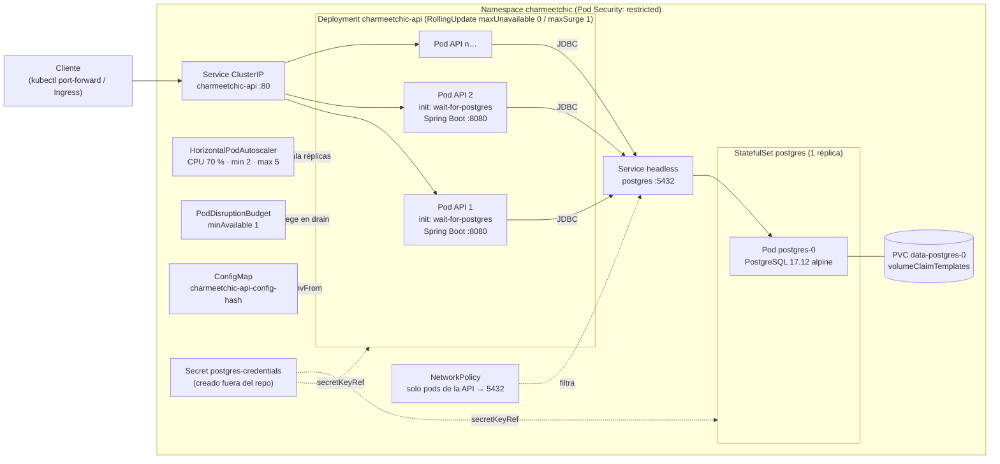

# Orquestación con Kubernetes

Despliegue de **charmeetchic-api** en Kubernetes con Kustomize: arquitectura, cómo desplegarlo en un clúster local
con [kind](https://kind.sigs.k8s.io/) y la justificación de los parámetros de escalabilidad y seguridad. Los
manifiestos están en [`k8s/`](../k8s) y cada parámetro está comentado en el propio YAML. Volver al
[README](../README.md) · Pipeline en [workflow.md](workflow.md).

---

## Arquitectura



| Recurso | Archivo | Para qué |
|---|---|---|
| Namespace | `base/namespace.yaml` | Aísla la aplicación. Etiquetas de **Pod Security Admission `restricted`**: el API server rechaza pods inseguros. |
| ConfigMap | `base/kustomization.yaml` (`configMapGenerator`) | `SPRING_PROFILES_ACTIVE=k8s`, `DB_URL`, `FIREBASE_PROJECT_ID`, `JWT_MODE`, `JAVA_OPTS`. Nombre con hash: un cambio dispara un rolling update. |
| Deployment | `base/api-deployment.yaml` | Las réplicas de la API (sin estado). |
| Service ClusterIP | `base/api-service.yaml` | IP y DNS estables delante de las réplicas; solo envía tráfico a pods Ready. |
| HorizontalPodAutoscaler | `base/api-hpa.yaml` | Escala la API según CPU (requiere metrics-server). |
| PodDisruptionBudget | `base/api-pdb.yaml` | Impide que un mantenimiento (drain) deje la API sin pods. |
| StatefulSet | `base/postgres-statefulset.yaml` | PostgreSQL con nombre estable y volumen persistente propio. |
| Service headless | `base/postgres-service.yaml` | DNS `postgres` → IP del pod de PostgreSQL. |
| NetworkPolicy | `base/postgres-networkpolicy.yaml` | Solo los pods de la API llegan al puerto 5432. |
| Secret (ejemplo) | `base/postgres-secret.example.yaml` | Documenta el Secret esperado. **No** se aplica ni tiene valores reales. |

### Por qué PostgreSQL

La API usa H2 en memoria. Con varias réplicas, cada pod tendría **su propia base**: un producto creado a través de un
pod no existiría en los otros. En Kubernetes la API usa el perfil `k8s`
([`application-k8s.yml`](../src/main/resources/application-k8s.yml)), que se conecta a PostgreSQL con URL, usuario y
contraseña desde variables de entorno. H2 sigue siendo el default para desarrollo y tests.

| Ajuste del perfil `k8s` | Motivo |
|---|---|
| `ddl-auto: update` | `create-drop` (el default con H2) borraría las tablas en cada arranque o apagado de un pod, es decir, en cada rolling update o escalado. |
| `sql.init.mode: always` | Con una base no embebida Spring Boot no ejecuta `data.sql` por defecto. Se puede desactivar con `DB_INIT_MODE=never`. |
| `data.sql` idempotente | Se ejecuta en cada arranque de cada réplica sobre una base que ya tiene datos. Cada `INSERT ... SELECT ... WHERE NOT EXISTS` usa la clave natural (nombre, SKU, producto+imagen); no se usa `MERGE` (solo H2) ni `ON CONFLICT` (solo PostgreSQL). Nunca indica ids: la columna `IDENTITY` los asigna y la secuencia queda sincronizada. |
| `hikari.maximum-pool-size: 5` | 5 conexiones por réplica. Con el máximo de prod (10 réplicas) son 50, bajo el `max_connections = 100` de PostgreSQL. |

### Estructura de `k8s/`

```
k8s/
├── kind-config.yaml               Clúster kind: 1 control-plane + 2 workers (Kubernetes 1.35.8, fijado por digest)
├── base/                          Recursos comunes (tabla de arriba)
└── overlays/
    ├── dev/                       kind: imagen charmeetchic-api:local, recursos bajos, HPA 2-3, JWT local
    │   ├── kustomization.yaml
    │   ├── patch-api-dev.yaml
    │   └── patch-postgres-dev.yaml
    └── prod/                      Producción: imagen del registro, 3 réplicas, HPA 3-10, PDB 2, más recursos
        ├── kustomization.yaml
        ├── patch-api-prod.yaml
        └── patch-postgres-prod.yaml
```

La base no se aplica sola: siempre se aplica un overlay (`kubectl apply -k k8s/overlays/dev`). Para ver el YAML final
sin aplicarlo: `kubectl kustomize k8s/overlays/dev`.

---

## Secretos

Ningún Secret con valores reales está en el repositorio. Los manifiestos solo **referencian** Secrets por nombre:

| Secret | Claves | Lo usan | Overlay |
|---|---|---|---|
| `postgres-credentials` | `POSTGRES_USER`, `POSTGRES_PASSWORD` | StatefulSet de PostgreSQL, Deployment de la API (`DB_USERNAME`, `DB_PASSWORD`) y su initContainer | todos |
| `charmeetchic-api-jwt-local` | `JWT_LOCAL_SECRET` | Deployment de la API (`JWT_MODE=local`) | solo dev |

**En local (kind)** se crean con `kubectl` y una contraseña aleatoria (paso 4 del despliegue). La contraseña no queda
en ningún archivo.

**En el CI/CD** (cuando exista un job de despliegue): la contraseña se guarda como secret de GitHub (*Settings →
Secrets and variables → Actions*, por ejemplo `POSTGRES_PASSWORD`, idealmente en un *environment* con aprobación) y
el job la pasa por variable de entorno, sin escribirla en disco ni en el log:

```bash
kubectl -n charmeetchic create secret generic postgres-credentials \
  --from-literal=POSTGRES_USER=charmeetchic \
  --from-literal=POSTGRES_PASSWORD="$POSTGRES_PASSWORD" \
  --dry-run=client -o yaml | kubectl apply -f -
```

El job actual `k8s-validate` no necesita el Secret: valida los manifiestos sin aplicarlos.

> Un Secret de Kubernetes solo está codificado en base64, no cifrado. En producción conviene activar el cifrado en
> reposo de etcd y/o un gestor externo (External Secrets Operator, Sealed Secrets, Secret Manager del proveedor).

---

## Despliegue en kind paso a paso

Requisitos: Docker Desktop, [kind](https://kind.sigs.k8s.io/docs/user/quick-start/#installation) (probado con
v0.33.0), `kubectl` y `openssl` (viene con Git Bash). Los comandos son para Git Bash, desde la raíz del repositorio.

**1. Crear el clúster** (1 control-plane + 2 workers):

```bash
kind create cluster --config k8s/kind-config.yaml
kubectl get nodes
```

**2. Instalar metrics-server** (lo necesita el HPA para leer la CPU). En kind los kubelets usan certificados
autofirmados, por eso se agrega `--kubelet-insecure-tls` (solo para el clúster local):

```bash
kubectl apply -f https://github.com/kubernetes-sigs/metrics-server/releases/download/v0.9.1/components.yaml
kubectl -n kube-system patch deployment metrics-server --type=json \
  -p '[{"op":"add","path":"/spec/template/spec/containers/0/args/-","value":"--kubelet-insecure-tls"}]'
kubectl -n kube-system rollout status deployment/metrics-server
```

**3. Construir la imagen y cargarla en los nodos** (kind no ve las imágenes del Docker local):

```bash
docker build -t charmeetchic-api:local .
kind load docker-image charmeetchic-api:local --name charmeetchic
```

La imagen de PostgreSQL la descarga cada nodo desde Docker Hub (por digest).

**4. Crear el namespace y los Secrets** (antes de los pods que los usan):

```bash
kubectl apply -f k8s/base/namespace.yaml
kubectl -n charmeetchic create secret generic postgres-credentials \
  --from-literal=POSTGRES_USER=charmeetchic \
  --from-literal=POSTGRES_PASSWORD="$(openssl rand -base64 24)"
kubectl -n charmeetchic create secret generic charmeetchic-api-jwt-local \
  --from-literal=JWT_LOCAL_SECRET="$(openssl rand -hex 32)"
```

**5. Aplicar el overlay dev y esperar**:

```bash
kubectl apply -k k8s/overlays/dev
kubectl -n charmeetchic rollout status statefulset/postgres
kubectl -n charmeetchic rollout status deployment/charmeetchic-api
kubectl -n charmeetchic get pods -o wide
```

**6. Probar la API**:

```bash
kubectl -n charmeetchic port-forward svc/charmeetchic-api 8080:80
# en otra terminal:
curl http://localhost:8080/api/health
curl "http://localhost:8080/api/products?size=3"
```

### Verificaciones

| Qué | Cómo |
|---|---|
| Pods Ready y repartidos | `kubectl -n charmeetchic get pods -o wide` (las 2 réplicas en workers distintos). |
| Base compartida | Crear un producto a través de un pod y leerlo en el otro, con un `port-forward` a cada pod (`kubectl port-forward pod/<pod> 18091:8080`). Crear productos exige rol ADMIN: en dev, un JWT HS256 firmado con `JWT_LOCAL_SECRET` y el claim `"ADMIN": true` (ver abajo). |
| HPA con métricas reales | `kubectl -n charmeetchic get hpa` y `kubectl -n charmeetchic top pods`. |
| Rolling update sin caída | Cambiar la anotación del commit y, mientras tanto, consultar `/api/health` en bucle desde un pod **dentro** del clúster (un `port-forward` al Service se fija en un solo pod y se corta cuando ese pod se elimina, lo que daría falsos errores). |
| Trazabilidad | `kubectl -n charmeetchic rollout history deployment/charmeetchic-api` (columna CHANGE-CAUSE) y la anotación `charmeetchic.cl/git-commit` de cada pod. |

Token de administrador para dev (Node.js, con el mismo secreto del paso 4):

```bash
SECRET=$(kubectl -n charmeetchic get secret charmeetchic-api-jwt-local -o jsonpath='{.data.JWT_LOCAL_SECRET}' | base64 -d)
TOKEN=$(node -e '
  const c = require("crypto"), b = o => Buffer.from(JSON.stringify(o)).toString("base64url");
  const now = Math.floor(Date.now() / 1000);
  const d = b({ alg: "HS256", typ: "JWT" }) + "." + b({ sub: "admin-dev", iat: now, exp: now + 3600, ADMIN: true });
  console.log(d + "." + c.createHmac("sha256", process.argv[1]).update(d).digest("base64url"));' "$SECRET")
curl -X POST http://localhost:18091/api/products -H "Authorization: Bearer $TOKEN" \
  -H "Content-Type: application/json" \
  -d '{"name":"Collar Kubernetes","description":"Demo","price":12345,"cost":5000,"sku":"K8S-DEMO-001","stock":7,"categoryId":1}'
```

Rolling update (cambiar la anotación del commit dispara un nuevo ReplicaSet):

```bash
SHA=$(git rev-parse --short HEAD)
kubectl -n charmeetchic patch deployment charmeetchic-api -p \
  "{\"metadata\":{\"annotations\":{\"kubernetes.io/change-cause\":\"commit $SHA\"}},\"spec\":{\"template\":{\"metadata\":{\"annotations\":{\"charmeetchic.cl/git-commit\":\"$SHA\"}}}}}"
kubectl -n charmeetchic rollout status deployment/charmeetchic-api
```

### Resultado observado en kind (Kubernetes 1.35.8, 3 nodos)

- 2 réplicas de la API Ready en workers distintos, 0 reinicios; el initContainer esperó a PostgreSQL y cada réplica
  arrancó en unos 45 s.
- Producto creado a través de una réplica (id 16) y leído en la otra: base compartida.
- `kubectl get hpa`: `cpu: 16%/70%` en reposo. Con carga (6 clientes en bucle) subió a más de 900 % y el HPA escaló
  de 2 a 3 réplicas (el máximo de dev) en unos 60 s.
- Rolling update: **1124 peticiones a `/api/health` durante el despliegue, 0 fallos**.
- NetworkPolicy: un pod sin la etiqueta de la API no puede abrir conexión a `postgres:5432`; un pod de la API sí.
- Ningún aviso de Pod Security al aplicar: todos los pods cumplen el nivel `restricted`.

### Limpieza

```bash
kubectl delete namespace charmeetchic     # borra todo, incluido el PVC con los datos
kind delete cluster --name charmeetchic   # borra el clúster
```

---

## Justificación de parámetros

### Escalabilidad y disponibilidad

| Parámetro | Valor (base) | Por qué |
|---|---|---|
| `replicas` | 2 | Alta disponibilidad mínima: si un pod o un nodo cae, el otro sigue atendiendo. Después manda el HPA. |
| `strategy.rollingUpdate` | `maxUnavailable: 0`, `maxSurge: 1` | Despliegue sin caída: no se baja un pod viejo hasta que el nuevo está Ready, y solo se necesita capacidad para 1 pod extra. |
| `topologySpreadConstraints` | `maxSkew 1` por nodo, `ScheduleAnyway` | Reparte las réplicas entre nodos para que la caída de uno no se lleve todas. Es preferencia: con un solo nodo los pods igual se programan. |
| HPA `averageUtilization` | 70 % del request de CPU | Deja un 30 % de margen para absorber picos mientras arrancan las réplicas nuevas (Spring Boot tarda decenas de segundos). |
| HPA `minReplicas` / `maxReplicas` | 2 / 5 | El piso mantiene la alta disponibilidad (y el PDB siempre permite sacar un pod); el techo limita el costo y las conexiones a PostgreSQL (5 × 5 = 25). |
| HPA `behavior.scaleUp` | ventana 30 s, máx. 2 pods/min | Reacciona rápido sin crear pods por un pico aislado, y da tiempo a que los nuevos bajen el promedio antes de crear más. |
| HPA `behavior.scaleDown` | ventana 300 s, 1 pod cada 2 min | Evita oscilar (*flapping*): no elimina pods que habría que recrear al minuto si la carga llega en oleadas. |
| PDB `minAvailable` | 1 | Un `kubectl drain` o una actualización del clúster nunca deja la API en cero. `unhealthyPodEvictionPolicy: AlwaysAllow` evita que un pod roto bloquee el drain. |
| `resources.requests` | 250m CPU, 768Mi | Lo que el scheduler reserva y la base del porcentaje del HPA. |
| `resources.limits` | 1 CPU, 768Mi | CPU holgada (4×) para que Spring Boot arranque rápido. Memoria request = limit: heap predecible y sin sobrecompromiso. |
| `JAVA_OPTS` | `-XX:MaxRAMPercentage=70.0 -XX:+ExitOnOutOfMemoryError` | Heap = 70 % del límite (768Mi → ~537Mi). El 30 % restante es para metaspace, threads y JIT; con más de ~75 % el contenedor arriesga OOMKilled. Ante un OOM la JVM termina y Kubernetes la reinicia. |
| `startupProbe` | `/api/health`, 5 s × 36 | Tolera hasta 180 s de arranque (CPU limitada en kind) sin retrasar la liveness con un `initialDelaySeconds` grande. |
| `readinessProbe` | 10 s, 3 fallos | Saca al pod del Service si deja de responder 30 s, sin reiniciarlo. |
| `livenessProbe` | 20 s, 3 fallos | Reinicia solo una JVM colgada (60 s sin responder); más tolerante que la readiness para no reiniciar un pod lento. |
| `preStop` + `terminationGracePeriodSeconds` | `sleep 10` + 40 s | Kubernetes saca el pod de los endpoints y manda SIGTERM casi a la vez; los 10 s dan tiempo a que kube-proxy deje de enviarle tráfico. Luego Spring cierra ordenadamente (`server.shutdown=graceful`, `timeout-per-shutdown-phase=20s`): 10 + 20 = 30 s < 40 s, así nunca llega el SIGKILL. |
| `initContainer wait-for-postgres` | `pg_isready` en bucle | Evita que la API arranque antes que la base y caiga en CrashLoopBackOff en el primer despliegue. |
| ConfigMap con hash | `configMapGenerator` | Cambiar la configuración cambia el nombre del ConfigMap y dispara un rolling update; con nombre fijo los pods seguirían con la configuración vieja. |
| PostgreSQL `StatefulSet` + `volumeClaimTemplates` | 1 réplica, 1Gi | Nombre estable (`postgres-0`) y volumen propio que sobrevive a reinicios. El PVC se conserva aunque se borre el StatefulSet. |

### Por entorno (overlays)

| Parámetro | dev (kind) | base | prod |
|---|---|---|---|
| Imagen | `charmeetchic-api:local` (`kind load`) | `charmeetchic-api` | `ghcr.io/dgomezpalacios/charmeetchic-api` (tag o digest) |
| Réplicas iniciales | 2 | 2 | 3 |
| HPA min / max | 2 / 3 | 2 / 5 | 3 / 10 |
| PDB `minAvailable` | 1 | 1 | 2 |
| API requests / limits | 100m, 512Mi / 1 CPU, 512Mi | 250m, 768Mi / 1 CPU, 768Mi | 500m, 1Gi / 2 CPU, 1Gi |
| Heap (70 % del límite) | ~358Mi | ~537Mi | ~717Mi |
| PostgreSQL requests / limits | 50m, 128Mi / 500m, 256Mi | 100m, 256Mi / 500m, 512Mi | 500m, 1Gi / 2 CPU, 1Gi |
| Disco PostgreSQL | 1Gi | 1Gi | 10Gi |
| `JWT_MODE` | `local` (tokens HS256 de prueba) | `firebase` | `firebase` |

En dev el HPA queda en mínimo 2 (y no 1) para poder probar la base compartida y el rolling update sin caída con dos
réplicas, y en máximo 3 para que todo quepa en un PC. Como el request de CPU es bajo (100m), el HPA escala con poca
carga, lo que sirve para verlo en acción.

### Seguridad

| Medida | Dónde | Qué evita |
|---|---|---|
| Pod Security Admission `restricted` | Namespace | El API server rechaza cualquier pod que corra como root, permita escalar privilegios, conserve capabilities o no use seccomp. Los `securityContext` pasan a ser obligatorios. |
| `runAsNonRoot`, `runAsUser: 1001` (API) / `70` (PostgreSQL) | Pod | Ningún proceso corre como root. 1001 es el usuario `app` del Dockerfile; 70, el usuario `postgres` de la imagen Alpine. |
| `allowPrivilegeEscalation: false` | Contenedores | Un proceso no puede ganar más privilegios que su padre (setuid, sudo). |
| `readOnlyRootFilesystem: true` + `emptyDir` | Contenedores | Nadie puede modificar el código ni dejar binarios en la imagen. Solo son escribibles `/tmp` (API) y los volúmenes de datos, socket y temporales (PostgreSQL). |
| `capabilities.drop: ["ALL"]` | Contenedores | Sin capabilities de Linux: la API escucha en 8080 (> 1024) y no necesita ninguna. |
| `seccompProfile: RuntimeDefault` | Pod | Bloquea llamadas al sistema peligrosas que una app web no usa. |
| `automountServiceAccountToken: false` | Pod | Un pod comprometido no obtiene credenciales del API server de Kubernetes. |
| `enableServiceLinks: false` | Pod | No inyecta variables de entorno de otros Services (ruido y posibles choques con la configuración de Spring). |
| NetworkPolicy | PostgreSQL | Solo los pods de la API llegan al puerto 5432; otro pod comprometido no alcanza la base. |
| Secrets fuera del repositorio | `postgres-credentials`, `charmeetchic-api-jwt-local` | Las contraseñas no quedan en Git. El ConfigMap solo tiene datos no secretos. |
| Imágenes fijadas por versión y digest | PostgreSQL, nodos de kind | El mismo manifiesto siempre despliega exactamente la misma imagen. La API usa un tag fijo (nunca `latest`). |
| `JWT_MODE=firebase` en base y prod | ConfigMap | El modo local (HS256) queda limitado al overlay dev. |
| `k8s-validate` en el CI | `.github/workflows/ci.yml` | `kubeconform -strict` rechaza campos inexistentes, que `kubectl` ignoraría en silencio (por ejemplo, un `securityContext` mal escrito que dejaría el pod sin protección). |

---

## Limitaciones conocidas

- **PostgreSQL con una sola réplica**: si `postgres-0` se reinicia, la API queda sin base unos segundos (la
  readinessProbe de PostgreSQL y el pool de Hikari se recuperan solos). La alta disponibilidad real exige un operador
  (CloudNativePG) o una base administrada (Cloud SQL, RDS).
- **Esquema con `ddl-auto: update` y `data.sql`**: suficiente para este proyecto, pero no versiona migraciones ni
  sirve para cambios destructivos. Para producción real se recomienda Flyway o Liquibase, que además toman un lock
  para que dos réplicas no migren a la vez. Hoy, si dos réplicas arrancan exactamente al mismo tiempo sobre una base
  vacía, una podría fallar por la restricción UNIQUE al cargar `data.sql` y Kubernetes la reiniciaría (en la prueba no
  ocurrió).
- **Overlay prod sin imagen publicada**: el job `docker-build` construye y escanea la imagen, pero no la publica en un
  registro. Para desplegar prod hay que publicarla (por ejemplo, en GHCR) y fijar el digest con
  `kustomize edit set image`.
- **Sin Ingress**: el Service es ClusterIP; en kind se accede con `kubectl port-forward`. En un clúster real se agrega
  un Ingress (o Gateway API) con TLS.
