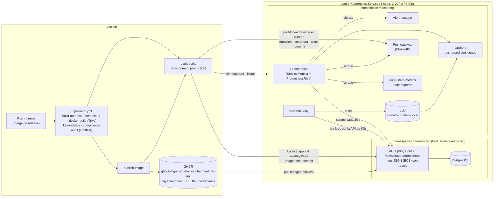

# Observabilidad, métricas y cumplimiento automatizado (Evaluación 3)

Este documento explica cómo se observa la API en ejecución (métricas, logs y alertas), qué publica el pipeline sobre
cada despliegue, qué políticas de cumplimiento se verifican de forma automática y en qué puntos el pipeline se
detiene ante una falla crítica.

| Pieza | Dónde está |
|---|---|
| Métricas y logs de la API | `pom.xml` (Actuator, Micrometer, Brave), `application.yml` (`management.*`), `application-k8s.yml` (logs JSON), `SecurityConfig` |
| Stack de monitoreo | [`k8s/observability/`](../k8s/observability) (values de Helm, versiones fijas en `versions.env`, ServiceMonitor, PrometheusRule, dashboard) |
| Overlay del clúster AKS | [`k8s/overlays/aks/`](../k8s/overlays/aks) |
| Políticas de cumplimiento | [`policy/`](../policy) (Rego, tests, excepciones, catálogo de controles y scripts) |
| Pipeline | [`.github/workflows/ci.yml`](../.github/workflows/ci.yml): jobs `compliance-audit` y `deploy-aks`, outputs de `build-and-test` |
| Publicación de métricas del pipeline | [`scripts/ci/push-deploy-metrics.sh`](../scripts/ci/push-deploy-metrics.sh) |

---

## Arquitectura



- **Métricas de la API**: Micrometer mide cada petición HTTP (`http_server_requests_seconds`, con histograma y un
  bucket SLO de 300 ms), la JVM, HikariCP y Tomcat. Todas llevan la etiqueta `application="charmeetchic-api"`.
  Solo se exponen `GET /api/actuator/health` (sin detalles) y `GET /api/actuator/prometheus`, sin token; el resto de
  Actuator no se expone y además exige autenticación (`ActuatorSecurityIntegrationTest` lo verifica).
- **Logs**: en el perfil `k8s` cada línea de stdout es un JSON ECS (`@timestamp`, `log.level`, `log.logger`,
  `message`, `service.name`, `traceId`, `spanId`...). Alloy los lee a través de la API de Kubernetes (sin montar
  `/var/log` del nodo ni correr como root) y los envía a Loki; extrae `log.level` como label `level`.
- **Métricas del clúster**: kube-state-metrics (réplicas, reinicios, límites) y node-exporter (CPU, memoria y disco
  del nodo); cAdvisor del kubelet aporta CPU y memoria por contenedor.
- **Métricas del pipeline**: el job `deploy-aks` las empuja al Pushgateway por `kubectl port-forward` (el Pushgateway
  es ClusterIP: no está expuesto a internet) y Prometheus las lee de ahí.
- **Mensajería apagada en Kubernetes**: el ConfigMap fija `MESSAGING_ENABLED=false` y `STREAMING_ENABLED=false`. En
  kind y AKS no hay RabbitMQ ni Kafka (solo existen en docker-compose: Codespaces/PC y la VM de Azure); con los
  interruptores encendidos la API intentaría conectarse en cada arranque y llenaría Loki de errores de conexión. El
  indicador de salud de RabbitMQ sigue al mismo interruptor, así `/api/actuator/health` no da 503 por un broker que
  no existe.
- **NetworkPolicy**: la única política del namespace protege a PostgreSQL (solo la API llega al 5432). La API no
  tiene una política de ingreso, así que Prometheus (namespace `monitoring`) la puede leer sin cambios. Si se agregara
  una política de ingreso para la API, debe permitir el puerto `http` desde el namespace `monitoring`.

### Versiones fijas

| Componente | Chart | Versión del chart | App |
|---|---|---|---|
| Prometheus, Alertmanager, Grafana, node-exporter, kube-state-metrics, Prometheus Operator | `prometheus-community/kube-prometheus-stack` | 93.9.0 | Operator v0.95.2 |
| Loki (SingleBinary, filesystem) | `grafana/loki` | 7.7.0 | 3.6.20 |
| Grafana Alloy (reemplaza a Promtail, deprecado) | `grafana/alloy` | 1.16.0 | v1.22.0 |
| Pushgateway | `prometheus-community/prometheus-pushgateway` | 3.11.2 | v1.11.4 |

Herramientas del CI con versión fija y SHA-256: conftest 0.71.1, helm v3.22.1, kustomize v5.8.3, kubectl v1.35.8,
kubeconform v0.8.0.

### Overlay `aks`: por qué no se usa `prod` tal cual

El overlay `prod` reserva **2 vCPU de requests** (3 réplicas × 500m + PostgreSQL 500m), es decir, el nodo completo.
En un nodo de 2 vCPU, AKS deja ~1,9 vCPU asignables y sus propios pods de sistema ya reservan una parte importante, a
lo que se suma el monitoreo. Con `prod`, los pods de la API quedarían en `Pending`. El overlay `aks` hereda la misma
base (imagen de GHCR, seguridad, probes, `JWT_MODE=firebase`) y solo ajusta capacidad:

| | `prod` | `aks` |
|---|---|---|
| Réplicas de la API (HPA) | 3 (3-10) | 2 (2-3) |
| API requests / limits | 500m-1Gi / 2-1Gi | 100m-768Mi / 1-768Mi |
| PostgreSQL requests / limits | 500m-1Gi / 2-1Gi | 50m-256Mi / 500m-512Mi |
| Disco de PostgreSQL | 10Gi | 4Gi |
| PDB `minAvailable` | 2 | 1 (base) |

**Requests medidos en AKS** (Standard_D2s_v4, Kubernetes 1.36, `kubectl describe node` con todo desplegado):
**1637m de 1900m de CPU (86 %) y 4462 Mi de 5789 Mi de memoria (77 %)**. Los pods de sistema de AKS (CoreDNS,
metrics-server, CSI de discos y archivos, Azure NPM, konnectivity, etc.) reservan ~0,93 vCPU y ~1 GB por sí solos; el
monitoreo ~0,4 vCPU y ~1,5 GB; la API y PostgreSQL 0,25 vCPU y ~1,8 GB. El margen restante (~260m y ~1,3 GB) alcanza
para el pod extra del rolling update (`maxSurge: 1`, 100m/768Mi) o para la tercera réplica del HPA. Con `prod` se
habría necesitado 2 vCPU solo para la API y PostgreSQL. El uso real es mucho menor que lo reservado (~0,4 vCPU y
~3,2 GB en `kubectl top node`); los límites de CPU (1 núcleo por réplica) usan esa CPU ociosa sin reservarla.

---

## Qué métrica responde a qué pregunta

| Pregunta técnica | Métrica (fuente) | Umbral / alerta | Decisión que permite tomar |
|---|---|---|---|
| ¿La API está arriba? | `up{job="charmeetchic-api"}` (Prometheus) y `kube_deployment_status_replicas_available` (kube-state-metrics) | `CharmeetchicApiTargetDown`: `up == 0` por 2 min (critical). `CharmeetchicApiSinReplicas`: 0 réplicas disponibles o ningún target UP por 1 min (critical) | Si coincide con un despliegue: `kubectl rollout undo`. Si no: revisar eventos y logs del pod |
| ¿Cuántas peticiones recibe y en qué endpoints? | `rate(http_server_requests_seconds_count[5m])` por `uri` (Micrometer) | Sin alerta (panel de capacidad) | Dimensionar réplicas y requests; decidir qué endpoints optimizar o cachear |
| ¿La API está fallando? | Proporción de `status=~"5.."` sobre el total (Micrometer) | `CharmeetchicApiErrores5xxAltos`: > 5 % por 5 min con > 0,1 req/s (critical) | Rollback del último despliegue o corrección; ver el panel de logs de error con su `traceId` |
| ¿Los clientes envían peticiones inválidas o sin token? | Tasa de `status=~"4.."` (Micrometer) | Sin alerta (panel) | Un salto de 401/403 tras un despliegue indica un problema de autenticación (Firebase) o del frontend |
| ¿La API responde rápido? | p50 / p95 con `histogram_quantile` sobre `http_server_requests_seconds_bucket` (todas las réplicas) | `CharmeetchicApiLatenciaP95Alta`: p95 > 300 ms por 10 min (warning) | Escalar (subir `maxReplicas` o requests de CPU), revisar consultas a PostgreSQL |
| ¿Un pod se está quedando sin memoria? | `container_memory_working_set_bytes` / `kube_pod_container_resource_limits{resource="memory"}` | `CharmeetchicPodMemoriaCercaDelLimite`: > 90 % por 5 min (warning) | Subir el límite (y `MaxRAMPercentage`) o investigar una fuga antes del OOMKilled |
| ¿Los pods se reinician? | `increase(kube_pod_container_status_restarts_total[15m])` (kube-state-metrics) | `CharmeetchicPodReiniciando`: > 2 en 15 min (warning) | `kubectl describe pod` (OOMKilled, liveness, CrashLoopBackOff) y logs del contenedor anterior |
| ¿Cuánta CPU usa cada pod frente a su límite? | `rate(container_cpu_usage_seconds_total[5m])` (cAdvisor) | Sin alerta; el HPA escala al 70 % del request | Ajustar requests (base del HPA) y límites |
| ¿Qué errores tuvo la API recién? | Logs `{namespace="charmeetchic", container="api"} \| json \| log_level="ERROR"` (Loki) | Panel de logs | Diagnóstico con el `traceId` de la petición que falló |
| ¿Cuánto tarda un despliegue? | `charmeetchic_deploy_duration_seconds{environment}` (Pushgateway) | Panel: verde < 5 min, naranja < 10 min, rojo después | Si crece, revisar arranque de Spring, probes o tamaño de la imagen |
| ¿Con qué calidad se desplegó? | `charmeetchic_coverage_lines_percent`, `charmeetchic_coverage_branches_percent`, `charmeetchic_tests_total` (Pushgateway) | Umbrales del `pom.xml` (93 % líneas, 82 % ramas): bajo eso el pipeline ni siquiera despliega | Ver la tendencia de calidad por despliegue y justificar nuevos tests |
| ¿Qué versión exacta corre en producción y desde cuándo? | `charmeetchic_deploy_info{commit, image, run_id}` y `charmeetchic_deploy_timestamp_seconds` (Pushgateway) | Panel | Correlacionar un cambio de errores o latencia con un commit y su ejecución del CI |

### Dashboard

*Charme et Chic - API y pipeline* (`uid: charmeetchic-api`, carpeta *Charme et Chic*), versionado en
[`k8s/observability/dashboards/charmeetchic-api.json`](../k8s/observability/dashboards/charmeetchic-api.json) y
provisionado por un ConfigMap con la label `grafana_dashboard: "1"` (el sidecar de Grafana lo carga solo):

1. **Disponibilidad**: réplicas UP, réplicas disponibles/deseadas, disponibilidad de 24 h y reinicios.
2. **Recursos por pod**: CPU y memoria de cada pod con su límite como línea punteada.
3. **Tráfico, errores y latencia**: req/s por endpoint, 5xx y 4xx (y % de 5xx), p50/p95 con el umbral de 300 ms.
4. **Logs**: logs de error recientes de la API (Loki).
5. **Pipeline**: duración del último despliegue por entorno, cobertura de líneas y ramas, tests, hora del último
   despliegue y commit/imagen/run desplegados.

### Alertas

Definidas en [`k8s/observability/api-prometheusrule.yaml`](../k8s/observability/api-prometheusrule.yaml) (las de la
tabla de arriba), además de las reglas por defecto de kube-prometheus-stack para nodos y Kubernetes (las del plano de
control administrado de AKS se desactivan porque no son accesibles). Se ven en Prometheus (*Alerts*) y en
Alertmanager. No hay un receptor configurado (correo/Slack) porque sería un secreto adicional; se agregaría en
`alertmanager.config` con la credencial desde un Secret.

---

## Políticas de cumplimiento

Las políticas son código OPA/Rego en [`policy/`](../policy) y las evalúa **conftest** en el job `compliance-audit`
sobre los manifiestos **renderizados** (lo que realmente se aplica): `kustomize build` de los overlays `dev`, `prod` y
`aks` y de `k8s/observability`, el pod del smoke test y `helm template` de los cuatro charts del monitoreo con
nuestros values. Cada mensaje de incumplimiento cita el control normativo.

| Regla | Qué verifica | Control normativo | Herramienta | Qué bloquea |
|---|---|---|---|---|
| K8S-01 | Contenedores no root (`runAsNonRoot: true`, `runAsUser != 0`) | CIS Kubernetes Benchmark 5.2.6 | conftest (`policy/kubernetes`) | Un workload que pueda correr como root |
| K8S-02 | Sin `privileged: true` | CIS Kubernetes Benchmark 5.2.2 | conftest | Un contenedor con acceso total al nodo |
| K8S-03 | `allowPrivilegeEscalation: false` explícito | CIS Kubernetes Benchmark 5.2.5 | conftest | Un proceso que pueda ganar privilegios (setuid) |
| K8S-04 | `readOnlyRootFilesystem: true` | CIS Kubernetes Benchmark 5.7.3 | conftest | Un contenedor cuyo sistema de archivos se pueda modificar |
| K8S-05 | `capabilities.drop: ["ALL"]` | CIS Kubernetes Benchmark 5.2.9 | conftest | Un contenedor que conserve capabilities de Linux |
| K8S-06 | requests y limits de CPU y memoria | ISO/IEC 27001:2022 A.8.6 (gestión de capacidad) | conftest | Un contenedor que pueda agotar el nodo |
| K8S-07 | liveness y readiness en workloads de larga duración | ISO/IEC 27001:2022 A.8.16 (actividades de monitoreo) | conftest | Un servicio que no se reinicia ni sale del balanceo al fallar |
| K8S-08 | Imágenes con tag fijo o digest, nunca `latest` ni sin tag | NIST SSDF SP 800-218 PW.4.1 | conftest | Una imagen no reproducible ni rastreable |
| K8S-09 | Sin `hostNetwork`, `hostPID` ni `hostIPC` | CIS Kubernetes Benchmark 5.2.3-5.2.4 | conftest | Un pod que comparta la red o los procesos del nodo |
| K8S-10 | Labels de trazabilidad: `app.kubernetes.io/name` + `part-of` (propios) o chart + release (Helm) | ISO/IEC 27001:2022 A.5.9 (inventario de activos) | conftest | Un recurso que no se puede atribuir a una app, chart o release |
| GHA-01 | `permissions` a nivel raíz del workflow, solo lectura | NIST SSDF SP 800-218 PO.5.1 | conftest (`policy/workflow`) | Un `GITHUB_TOKEN` con escritura por defecto |
| GHA-02 | Actions de terceros fijadas por SHA de commit | NIST SSDF SP 800-218 PW.4.1 | conftest | Una action de terceros referenciada por un tag movible |
| REPO-01 | Cada entrada de `.trivyignore` con `exp:` y justificación | NIST SSDF SP 800-218 RV.2.2 | conftest (`policy/repo`) | Un riesgo aceptado sin vencimiento ni motivo |
| REPO-02 | Sin `*.pem`, `*-admin-key*.json` ni `.env` versionados | OWASP ASVS 4.0.3 V2.10.4 | conftest + `git ls-files` | Una credencial en el repositorio |
| REPO-03 | Excepciones con justificación y vencimiento ≤ 1 año | ISO/IEC 27001:2022 A.5.36 (cumplimiento de políticas) | conftest | Una excepción permanente o sin justificar |

Complementan a las políticas (no son conftest): **Trivy** (vulnerabilidades de la imagen, NIST SSDF RV.1.1),
**SonarCloud** (calidad y seguridad del código, NIST SSDF PW.7.2), **Pod Security Admission `restricted`** en el
namespace `charmeetchic` (el API server rechaza pods inseguros en tiempo de ejecución) y **secret scanning** de GitHub.

**Excepciones** ([`policy/data/exceptions.yaml`](../policy/data/exceptions.yaml)): solo para componentes de terceros
del monitoreo y con vencimiento (al vencer, la regla vuelve a fallar):

| Id | Regla | Recurso | Motivo |
|---|---|---|---|
| EXC-01 | K8S-09 | DaemonSet `kps-prometheus-node-exporter` | Necesita `hostNetwork`/`hostPID` para medir el nodo; corre como no root, sin escalada, raíz de solo lectura y sin capabilities |
| EXC-02/03 | K8S-07 | Sidecars `grafana-sc-dashboard` y `grafana-sc-datasources` | No exponen endpoint de salud; el contenedor de Grafana sí tiene probes |
| EXC-04 | K8S-07 | Sidecar `config-reloader` de Alloy | Igual que el anterior; Alloy tiene liveness y readiness |

Los manifiestos propios (`k8s/base`, overlays, `k8s/ci`, `k8s/observability`) cumplen todo sin excepciones. Al
escribir las políticas aparecieron dos incumplimientos reales en la base (el Namespace y el ConfigMap sin
`app.kubernetes.io/name`), que se corrigieron; y en los charts se corrigieron por values el endurecimiento del
Pushgateway, la liveness de Loki y de Alloy, los recursos del config-reloader y el pod de test de Grafana.

**Reporte**: el job escribe el reporte en Markdown en el *Job Summary* (resultado por objetivo, incumplimientos con su
control, advertencias, excepciones vigentes y catálogo de controles) y sube el artefacto `reporte-cumplimiento` con
`compliance-report.json` y los manifiestos evaluados. Las políticas tienen sus propios tests (`*_test.rego`, 41 casos)
que corren con `conftest verify` antes de auditar.

```bash
# En local (requiere conftest, kustomize, helm y jq):
conftest verify --policy policy --data policy/data
policy/scripts/compliance-audit.sh compliance-report      # sale con 1 si hay incumplimientos
```

Ejemplo de incumplimiento (contenedor privilegiado y sin `limits`):

```text
$ conftest test privilegiado.yaml --policy policy --data policy/data --namespace kubernetes
FAIL - privilegiado.yaml - kubernetes - [K8S-02] Deployment/demo/inseguro: el container 'app' es privileged: true (control: CIS Kubernetes Benchmark 5.2.2)
FAIL - privilegiado.yaml - kubernetes - [K8S-06] Deployment/demo/inseguro: el container 'app' no define resources.limits.cpu (control: ISO/IEC 27001:2022 A.8.6)
FAIL - privilegiado.yaml - kubernetes - [K8S-06] Deployment/demo/inseguro: el container 'app' no define resources.limits.memory (control: ISO/IEC 27001:2022 A.8.6)

14 tests, 11 passed, 0 warnings, 3 failures, 0 exceptions        (código de salida 1)
```

---

## Cómo se detiene el pipeline ante fallas críticas

Cada gate es un job o un step que termina con error; un job en rojo detiene a los que dependen de él (`needs`) y, en
un PR, bloquea el merge si es check requerido.

| # | Gate | Dónde | Qué lo hace fallar | Efecto |
|---|---|---|---|---|
| 1 | Tests unitarios y de integración | `build-and-test` (`mvn test`, `mvn verify`) | Un test en rojo | Se detiene todo: ningún otro job corre (todos dependen de `build-and-test`) |
| 2 | Cobertura mínima | `build-and-test` (JaCoCo `check`) | Líneas < 93 % o ramas < 82 % (servicios: 95 % / 85 %) | Igual que el anterior |
| 3 | Smoke test del JAR | `build-and-test` | `/api/health` no responde en 60 s | Igual que el anterior |
| 4 | Quality gate de SonarCloud | `sonarcloud` (`sonar.qualitygate.wait=true`) | El código nuevo no cumple el quality gate | Bloquea el merge (check requerido recomendado) y **`deploy-aks` no corre** |
| 5 | Trivy | `docker-build` | Una vulnerabilidad CRITICAL con corrección disponible | Bloquea el merge; `publish-image` no publica, así que ni `deploy` ni `deploy-aks` corren |
| 6 | Validación de manifiestos | `k8s-validate` (kubeconform `-strict`, CRDs incluidas) | Un campo inexistente o mal ubicado | Bloquea el merge; `deploy` y `deploy-aks` no corren |
| 7 | Políticas de cumplimiento | `compliance-audit` (conftest verify + test) | Cualquier incumplimiento (deny) o un test de política roto | Bloquea el merge (check requerido); `deploy-aks` no corre |
| 8 | GitFlow | `gitflow-guard` | Un PR hacia `main` que no viene de `develop` ni de `hotfix/*` | Bloquea el merge en `main` |
| 9 | Aprobación de production | GitHub Environment `production` (*Required reviewers*) | Nadie aprueba | `deploy` y `deploy-aks` esperan; sin aprobación no despliegan |
| 10 | Rollout | `deploy` / `deploy-aks` (`kubectl rollout status`) | Los pods no quedan Ready en 10 min | El job falla e imprime el diagnóstico; con `maxUnavailable: 0` las réplicas anteriores siguen atendiendo |
| 11 | Smoke test en el clúster | `deploy` / `deploy-aks` (pod con curl contra el Service) | `/api/health` sin `UP`, versión distinta o `/api/products` ≠ 200 | El job falla; en AKS no se publican métricas de ese despliegue |
| 12 | Prometheus lee la API | `deploy-aks` | Ningún target `up == 1` en 2 min | El job falla: el despliegue no es observable |
| 13 | Inmutabilidad de la imagen | `publish-image` | Un tag `vX.Y.Z` sobre un commit sin `sha-<commit>` publicado, un error de GHCR distinto de *not found*, o un tag promovido que no queda en el digest de `sha-<commit>` | No se construye ni se sobrescribe nada; sin imagen, `deploy` y `deploy-aks` no corren |
| 14 | Despliegue por digest | `deploy` / `deploy-aks` | `publish-image` no entregó el digest, o el YAML final de AKS no fija `imagen@sha256:…` | El job falla antes del `kubectl apply` |

### Incidente: el tag de versión sobrescribió `sha-<commit>` (v3.0.0)

**Qué pasó.** El merge del PR #36 a `main` publicó `ghcr.io/dgomezpalacios/charmeetchic-api:sha-38a1369` con el
digest `59c4…`. Después, el push del tag `v3.0.0` **sobre el mismo commit** volvió a ejecutar `publish-image`, que
**reconstruyó** la imagen y publicó otra vez `sha-38a1369`, ahora con el digest `150b…` (un build nuevo nunca es
idéntico bit a bit: cambian las fechas de las capas, el SBOM y la provenance). El job `deploy` comparó el digest de la
imagen descargada con el que le entregó `publish-image`, detectó la diferencia y se detuvo. La verificación funcionó,
pero el tag que debía ser inmutable había dejado de serlo: lo que se probó y escaneó (`59c4…`) ya no era lo que el
tag `sha-38a1369` entregaba.

**Causa.** `publish-image` construía en **todos** los push, también en los tags de versión, y `metadata-action`
siempre incluía `sha-<commit>` en la lista de tags. Un tag de Git apunta a un commit ya publicado, así que el
resultado era un segundo build con el mismo nombre inmutable. Lo mismo habría pasado con un *re-run* del job.

**Corrección (hotfix `hotfix/imagen-inmutable`).**

- **El tag promueve, no reconstruye.** En un push de `vX.Y.Z`, `publish-image` busca `sha-<commit>` en GHCR
  (`docker buildx imagetools inspect`) y agrega los tags `X.Y.Z` y `X.Y` **al mismo digest** con
  `docker buildx imagetools create`. Con una sola fuente, `imagetools create` copia el índice tal cual: se comprobó con
  `--dry-run` que el índice resultante tiene el mismo digest (`150bf3…` → `150bf3…`). Después de crear los tags, el
  job verifica que cada uno apunte a ese digest. Si `sha-<commit>` no existe (un tag sobre un commit cuyo pipeline no
  publicó imagen), el job falla con un mensaje claro en lugar de construir.
- **Un re-run no sobrescribe.** En un push a una rama, si `sha-<commit>` ya existe no se construye: se reutiliza su
  digest como output y solo se mueve el tag de la rama (`develop`/`main`, mutable por diseño). Solo un *not found*
  explícito habilita el build; cualquier otro error de GHCR detiene el job (ante la duda no se construye).
- **El build normal no cambia:** SBOM, provenance `mode=max` y la atestación de GitHub. La imagen promovida conserva
  los tres, porque el SBOM y la provenance viven dentro del índice y la atestación va ligada al digest.
- **Se despliega por digest.** `deploy-aks` fija la imagen como `ghcr.io/…@sha256:<digest>` con kustomize (los nodos
  de AKS descargan exactamente ese contenido, aunque un tag se mueva). `deploy` descarga `imagen@digest`, la
  etiqueta **localmente** como `sha-<commit>` y la carga con `kind load` (kind necesita un nombre con tag). Ambos
  agregan el digest al `change-cause` y la anotación `charmeetchic.cl/image-digest` al Deployment y a los pods.

**Efecto colateral aceptado.** La label OCI `org.opencontainers.image.version` de una imagen promovida es la del build
original (`main`), no `X.Y.Z`: cambiarla exigiría otro manifiesto y, por lo tanto, otro digest. La versión publicada
se lee en los tags `X.Y.Z`/`X.Y` y la versión de la aplicación en `/api/health`.

**Estado del tag afectado.** `sha-38a1369` sigue apuntando a `150b…`, el rebuild (verificado con
`docker buildx imagetools inspect`). No se reescribe a mano: se deja como evidencia del incidente, y el próximo
despliegue sale de un commit nuevo, ya con la promoción inmutable.

### Evidencia real

- **PR #14 (`feature/seguridad` → `develop`)**: el primer análisis de Trivy encontró **10 vulnerabilidades CRITICAL y
  29 HIGH** en las librerías de Spring Boot 3.2 (Tomcat, Spring Security, Spring MVC). El check `docker-build` quedó en
  rojo y el merge bloqueado (gate 5). Se corrigió en la misma rama (Spring Boot 3.5.16, Tomcat 10.1.62, Jackson
  2.21.7) hasta llegar a 0 CRITICAL; los dos riesgos que solo se corrigen con Spring Boot 4 quedaron en
  `.trivyignore` con justificación y vencimiento (ahora REPO-01 verifica que sigan así). Checks finales en verde:
  `build-and-test`, `sonarcloud`, `docker-build`, *Trivy* y *SonarCloud Code Analysis*.
  <https://github.com/DGomezPalacios/charmeetchic_api/pull/14>
- **PR #30 (`feature/deploy`)**: se abrió primero con base `main`; **`gitflow-guard` lo bloqueó** (gate 8) y la base
  se corrigió a `develop`, donde pasaron `build-and-test`, `sonarcloud`, `docker-build` y `k8s-validate`.
  <https://github.com/DGomezPalacios/charmeetchic_api/pull/30>
- **Esta rama**: `compliance-audit` en local detectó dos recursos propios sin label de trazabilidad (corregidos), y la
  prueba en el clúster detectó que `/api/actuator/health` respondía 503 por el indicador de RabbitMQ con la mensajería
  apagada (corregido y cubierto por el test de integración).

---

## Puesta en marcha en AKS

1. **Clúster** (una vez; ejemplo con la CLI de Azure, 1 nodo de 2 vCPU y 8 GB):

   ```bash
   az group create --name rg-charmeetchic --location eastus
   az aks create --resource-group rg-charmeetchic --name aks-charmeetchic \
     --node-count 1 --node-vm-size Standard_D2s_v3 --tier free --generate-ssh-keys
   az aks get-credentials --resource-group rg-charmeetchic --name aks-charmeetchic --file aks-config
   ```

2. **Secret `KUBE_CONFIG_AKS`** en el environment `production` (base64 del kubeconfig; el archivo nunca se versiona):

   ```bash
   base64 -w0 aks-config | gh secret set KUBE_CONFIG_AKS --env production
   ```

3. **Imagen pública** en GHCR (*Package settings → Change visibility → Public*): los nodos de AKS la descargan sin
   `imagePullSecret`.
4. **Push a `main`** (merge de una release): `deploy-aks` instala o actualiza el stack, despliega la API y publica las
   métricas. Todo es idempotente: volver a correrlo no duplica nada y conserva las contraseñas ya generadas.

### Instalación manual (misma secuencia que el job)

```bash
. k8s/observability/versions.env
kubectl apply -f k8s/observability/namespace.yaml
kubectl -n monitoring create secret generic grafana-admin \
  --from-literal=admin-user=admin --from-literal=admin-password="$(openssl rand -base64 24)"
helm upgrade --install kps kube-prometheus-stack --repo https://prometheus-community.github.io/helm-charts \
  --version "$KPS_CHART_VERSION" -n monitoring -f k8s/observability/kube-prometheus-stack-values.yaml --wait
helm upgrade --install loki loki --repo https://grafana.github.io/helm-charts \
  --version "$LOKI_CHART_VERSION" -n monitoring -f k8s/observability/loki-values.yaml --wait
helm upgrade --install alloy alloy --repo https://grafana.github.io/helm-charts \
  --version "$ALLOY_CHART_VERSION" -n monitoring -f k8s/observability/alloy-values.yaml --wait
helm upgrade --install pushgateway prometheus-pushgateway --repo https://prometheus-community.github.io/helm-charts \
  --version "$PUSHGATEWAY_CHART_VERSION" -n monitoring -f k8s/observability/pushgateway-values.yaml --wait
kubectl apply -k k8s/observability          # ServiceMonitor, PrometheusRule y dashboard (necesitan las CRDs)
```

---

## Acceso a Grafana y Prometheus

Ningún componente del monitoreo tiene IP pública: se accede con `kubectl port-forward` desde un equipo con el
kubeconfig.

```bash
# Grafana -> http://localhost:3000 (usuario admin)
kubectl -n monitoring get secret grafana-admin -o jsonpath='{.data.admin-password}' | base64 -d; echo
kubectl -n monitoring port-forward svc/kps-grafana 3000:80

# Prometheus -> http://localhost:9090 (Status -> Targets: charmeetchic-api debe estar UP; Alerts: reglas)
kubectl -n monitoring port-forward svc/kps-prometheus 9090:9090

# Alertmanager -> http://localhost:9093
kubectl -n monitoring port-forward svc/kps-alertmanager 9093:9093

# Pushgateway -> http://localhost:9091 (métricas que publicó el pipeline)
kubectl -n monitoring port-forward svc/pushgateway 9091:9091
```

En Grafana: *Dashboards → Charme et Chic → Charme et Chic - API y pipeline*. Para explorar logs: *Explore →
Loki* con `{namespace="charmeetchic", container="api"} | json`.

## Apagar el clúster para ahorrar crédito

AKS cobra por las VMs de los nodos mientras están encendidas (el plano de control del tier *Free* no se cobra).

```bash
az aks stop  --resource-group rg-charmeetchic --name aks-charmeetchic    # apaga los nodos; conserva configuración y discos
az aks start --resource-group rg-charmeetchic --name aks-charmeetchic    # vuelve a encenderlos (unos minutos)
az aks show  --resource-group rg-charmeetchic --name aks-charmeetchic --query powerState.code -o tsv
```

Con el clúster detenido, `deploy-aks` falla en *Configurar acceso al clúster AKS* (no hay API server): encenderlo antes
de mergear en `main`. Los discos (PostgreSQL, Prometheus, Loki, Pushgateway) siguen cobrando un monto menor; para
eliminar todo: `az group delete --name rg-charmeetchic`.

---

## Prueba local en kind

Antes de tener el kubeconfig de AKS, el mismo stack se probó en el clúster kind de `k8s/kind-config.yaml` (3 nodos,
Kubernetes 1.35.8), con los mismos values, el overlay `aks` (imagen construida en el PC) y el mismo script del
Pushgateway:

1. `helm upgrade --install` de los cuatro charts y `kubectl apply -k k8s/observability`: todos los pods `Running`.
2. Overlay `aks` desplegado (rollout en 68 s) y smoke test OK (`status UP`, `/api/products` 200).
3. `/api/actuator/prometheus` consultado desde un pod del clúster; `/api/actuator/env` sin token → 401.
4. Prometheus: los dos pods de la API y el Pushgateway como targets `UP`; las 6 alertas cargadas con `health=ok`.
5. `scripts/ci/push-deploy-metrics.sh` publicó duración, cobertura, tests, timestamp y commit.
6. Grafana: dashboard provisionado (15 paneles) y consultas de los paneles con datos (réplicas UP, req/s, p95,
   memoria por pod, duración del despliegue, commit).
7. Loki: logs de los namespaces `charmeetchic` y `monitoring`, líneas JSON parseadas con `| json` y con `traceId`.
