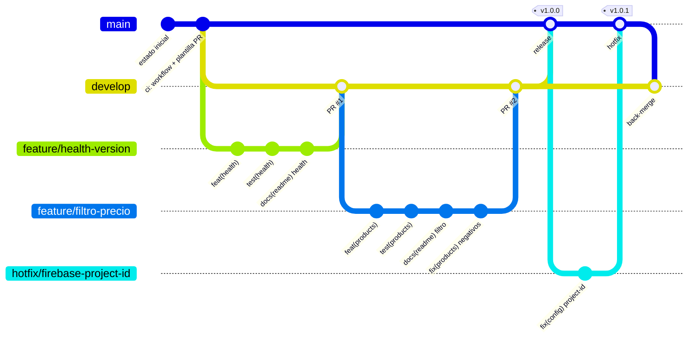
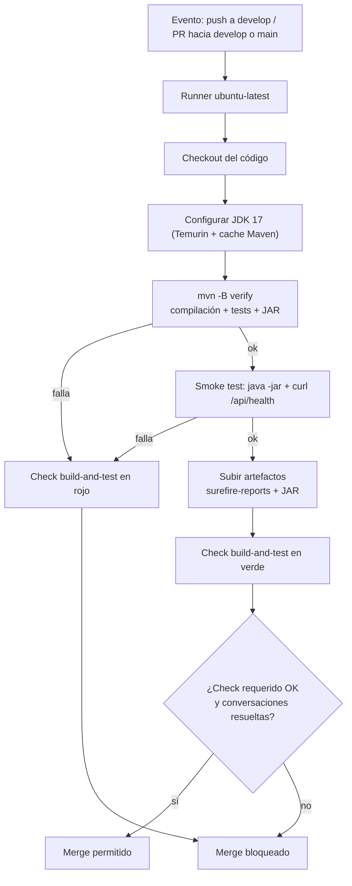

# Flujo de trabajo y pipeline de CI

Diagramas del modelo de ramas GitFlow y del pipeline de integración continua de **charmeetchic-api**. Las reglas
completas están en [CONTRIBUTING.md](../CONTRIBUTING.md). Volver al [README](../README.md).

---

## Flujo de ramas (GitFlow)

- Las features salen de `develop` y vuelven a `develop` mediante PR con merge commit.
- La release lleva `develop` a `main` y se marca con el tag anotado `v1.0.0`.
- El hotfix sale de `main`, vuelve a `main` con el tag `v1.0.1` y se hace back-merge a `develop`.

---

## Pipeline de CI

> Los reportes de tests (`surefire-reports`) se suben siempre (`if: always()`), incluso si el job falló, para poder
> diagnosticar el error.

---

## Cuándo se ejecuta el workflow

| Evento | Rama | ¿Se ejecuta el workflow? | Efecto |
|---|---|---|---|
| `push` | `develop` | Sí | Valida la integración después de cada merge en `develop`; el resultado se refleja en el badge del README. |
| `pull_request` | hacia `develop` | Sí | El check `build-and-test` aparece en el PR y es requerido para mergear. |
| `pull_request` | hacia `main` | Sí | Valida la release o el hotfix antes de llegar a producción; check requerido. |
| `push` | `feature/*` | No | No hay ejecución hasta que se abre el PR hacia `develop` (el workflow solo escucha `push` a `develop`). |

---

## Steps de `.github/workflows/ci.yml`

El workflow tiene un único job, `build-and-test`, que corre en `ubuntu-latest`:

1. **Checkout del código** (`actions/checkout@v4`): descarga el repositorio en el runner.
2. **Configurar JDK 17** (`actions/setup-java@v4`): instala Temurin 17 y activa el cache de dependencias Maven para
   acelerar las siguientes ejecuciones.
3. **Compilar y ejecutar tests** (`mvn -B verify`): compila, ejecuta los tests unitarios y de integración y empaqueta
   el JAR. Si algún test falla, el job falla.
4. **Smoke test del JAR**: levanta el JAR generado en segundo plano y consulta `GET /api/health` hasta 30 veces (cada
   2 segundos). Si la aplicación no responde, el job falla; así se verifica que el artefacto realmente arranca.
5. **Subir reportes de tests** (`actions/upload-artifact@v4`, `if: always()`): publica `target/surefire-reports/`
   como artefacto `surefire-reports`, aunque los pasos anteriores hayan fallado.
6. **Subir JAR generado** (`actions/upload-artifact@v4`): publica el JAR como artefacto `charmeetchic-api-jar`,
   descargable desde la ejecución en la pestaña *Actions*.
