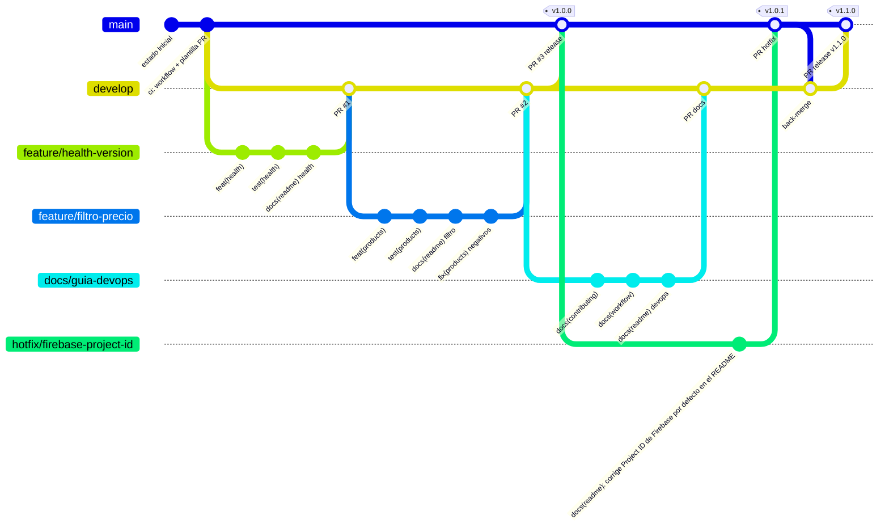
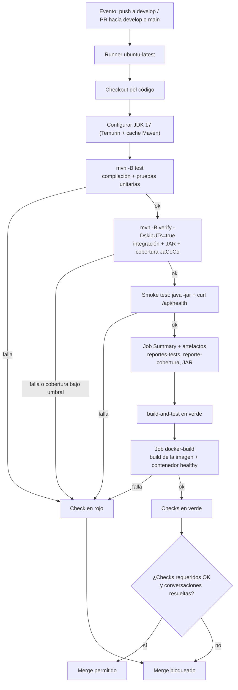

# Flujo de trabajo y pipeline de CI

Diagramas del modelo de ramas GitFlow y del pipeline de integración continua de **charmeetchic-api**. Las reglas
completas están en [CONTRIBUTING.md](../CONTRIBUTING.md). Volver al [README](../README.md).

---

## Flujo de ramas (GitFlow)

Secuencia real de versiones:

1. **Release `v1.0.0`**: el PR #3 lleva `develop` (PR #1 y PR #2) a `main`; el commit de merge se marca con el tag
   anotado `v1.0.0`.
2. **Documentación a `develop`**: `docs/guia-devops` (esta guía, `CONTRIBUTING.md` y la sección DevOps del README)
   se integra en `develop` mediante PR. Todavía no llega a `main`.
3. **Hotfix `v1.0.1`**: `hotfix/*` es una corrección urgente sobre `main` (producción). En este proyecto corrige
   documentación: el Project ID de Firebase por defecto indicado en el README de producción. Sale de `main`, vuelve
   a `main` con el tag `v1.0.1` y se hace back-merge de `main` a `develop` para no perder la corrección.
4. **Release `v1.1.0`**: un nuevo PR `develop → main` lleva la documentación y las convenciones a producción, junto
   con la corrección del hotfix ya incorporada en `develop`.

---

## Pipeline de CI

> El resumen y los reportes (`reportes-tests`, `reporte-cobertura`) se publican siempre (`if: always()`), incluso si
> el job falló, para poder diagnosticar el error. La política de umbrales está en
> [CONTRIBUTING.md](../CONTRIBUTING.md#política-de-calidad).

---

## Cuándo se ejecuta el workflow

| Evento | Rama | ¿Se ejecuta el workflow? | Efecto |
|---|---|---|---|
| `push` | `develop` | Sí | Valida la integración después de cada merge en `develop`; el resultado se refleja en el badge del README. |
| `pull_request` | hacia `develop` | Sí | El check `build-and-test` aparece en el PR y es requerido para mergear. |
| `pull_request` | hacia `main` | Sí | Valida la release o el hotfix antes de llegar a producción; check requerido. |
| `push` | `feature/*` | No | No hay ejecución hasta que se abre el PR hacia `develop` (el workflow solo escucha `push` a `develop`). |

---

## Steps de `.github/workflows/ci.yml`

El workflow tiene dos jobs que corren en `ubuntu-latest`. Job `build-and-test`:

1. **Checkout del código** (`actions/checkout@v4`): descarga el repositorio en el runner.
2. **Configurar JDK 17** (`actions/setup-java@v4`): instala Temurin 17 y activa el cache de dependencias Maven para
   acelerar las siguientes ejecuciones.
3. **Pruebas unitarias** (`mvn -B test`): compila y ejecuta solo las pruebas unitarias (surefire).
4. **Pruebas de integración y verificación de cobertura** (`mvn -B verify -DskipUTs=true`): ejecuta las pruebas
   `*IntegrationTest` (failsafe), empaqueta el JAR, genera el reporte de JaCoCo (unitarias + integración) y aplica
   los umbrales de cobertura. No recompila ni repite las unitarias.
5. **Smoke test del JAR**: levanta el JAR generado en segundo plano y consulta `GET /api/health` hasta 30 veces (cada
   2 segundos). Si la aplicación no responde, el job falla; así se verifica que el artefacto realmente arranca.
6. **Publicar resumen de tests y cobertura** (`if: always()`): script bash + awk que escribe en el *Job Summary* los
   tests por tipo y la cobertura de líneas y ramas.
7. **Subir reportes** (`actions/upload-artifact@v4`, `if: always()`): `reportes-tests` (surefire + failsafe) y
   `reporte-cobertura` (HTML de JaCoCo), aunque los pasos anteriores hayan fallado.
8. **Subir JAR generado** (`actions/upload-artifact@v4`): publica el JAR como artefacto `charmeetchic-api-jar`,
   descargable desde la ejecución en la pestaña *Actions*.

Job `docker-build` (`needs: build-and-test`): construye la imagen con Buildx (sin publicarla), levanta el contenedor,
espera el estado `healthy` y consulta `/api/health`.
