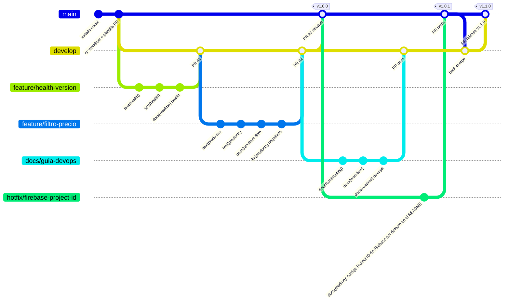
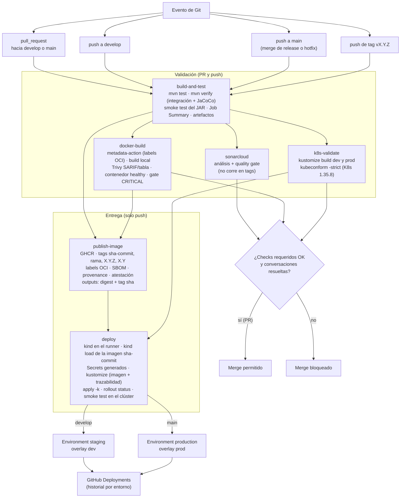
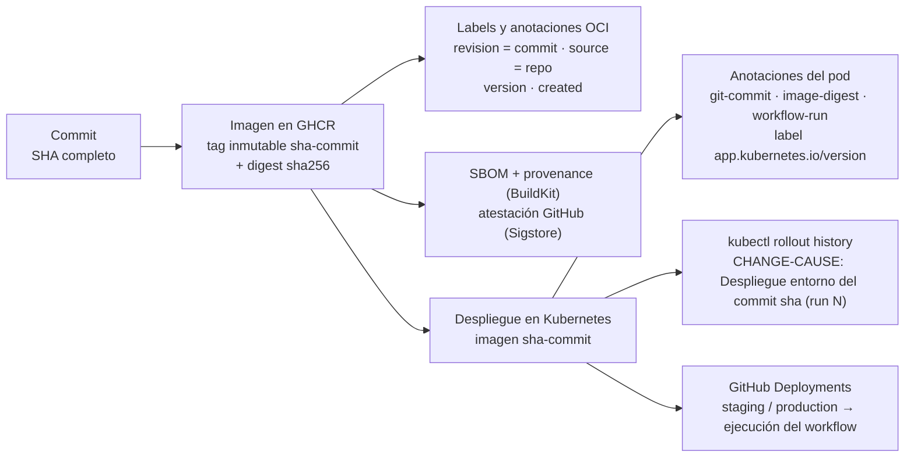

# Flujo de trabajo y pipeline de CI/CD

Diagramas del modelo de ramas GitFlow y del pipeline de integración y entrega continua (CI/CD) de **charmeetchic-api**. Las reglas
completas están en [CONTRIBUTING.md](../CONTRIBUTING.md). Volver al [README](../README.md).

---

## Flujo de ramas (GitFlow)

Secuencia real de versiones:

1. **Release `v1.0.0`**: el PR #3 lleva `develop` (PR #1 y PR #2) a `main`; el commit de merge se marca con el tag
   anotado `v1.0.0`.
2. **Documentación a `develop`**: `docs/guia-devops` (esta guía, `CONTRIBUTING.md` y la sección DevOps del README)
   se integra en `develop` mediante PR. Todavía no llega a `main`.
3. **Hotfix `v1.0.1`**: `hotfix/*` es una corrección urgente sobre `main` (producción). En este proyecto corrige
   documentación: el Project ID de Firebase por defecto indicado en el README de producción. Sale de `main`, vuelve
   a `main` con el tag `v1.0.1` y se hace back-merge de `main` a `develop` para no perder la corrección.
4. **Release `v1.1.0`**: un nuevo PR `develop → main` lleva la documentación y las convenciones a producción, junto
   con la corrección del hotfix ya incorporada en `develop`.

---

## Pipeline de CI/CD

El workflow [`ci.yml`](../.github/workflows/ci.yml) tiene seis jobs. Los cuatro primeros validan (corren también en
los PRs); `publish-image` y `deploy` entregan (solo corren en push, después de que la validación terminó en verde).

### Cuándo corre cada job

| Job | `pull_request` | push a `develop` | push a `main` | push de tag `vX.Y.Z` |
|---|:---:|:---:|:---:|:---:|
| `build-and-test` | ✅ | ✅ | ✅ | ✅ |
| `sonarcloud` | ✅ (no desde forks) | ✅ | ✅ | — |
| `docker-build` | ✅ | ✅ | ✅ | ✅ |
| `k8s-validate` | ✅ | ✅ | ✅ | ✅ |
| `publish-image` | — | ✅ tags `sha-…`, `develop` | ✅ tags `sha-…`, `main` | ✅ tags `sha-…`, `X.Y.Z`, `X.Y` |
| `deploy` | — | ✅ **staging** (overlay dev) | ✅ **production** (overlay prod) | — |

- Un **tag** no despliega: el commit etiquetado ya se desplegó en production cuando llegó a `main`; el tag solo agrega
  los nombres de versión `X.Y.Z` y `X.Y` a la imagen.
- **`publish-image` y `deploy` NO son checks requeridos** de la protección de ramas: no corren en los PRs (un PR no
  debe publicar artefactos ni desplegar, y un PR desde un fork no tendría permiso para escribir en el registro). Si
  se marcaran como requeridos, ningún PR podría mergearse, porque el check nunca aparecería. Corren después del merge,
  en el push a `develop` o `main`, y un fallo queda visible en la pestaña *Actions*, en el badge del README y en el
  historial del entorno.
- **Concurrencia**: en un PR, un commit nuevo cancela la ejecución anterior. En un push no se cancela: cortar a la
  mitad una publicación o un despliegue dejaría el entorno en un estado intermedio; la ejecución nueva espera.

---

## Cadena de trazabilidad

Desde cualquier punto se puede llegar al commit, y desde el commit a todo lo demás:

| Eslabón | Dónde se ve | Cómo |
|---|---|---|
| Commit → imagen | Job Summary de `publish-image`; paquete en GHCR | Tag `sha-<7 caracteres>` (no se reutiliza) y digest. `docker pull ghcr.io/dgomezpalacios/charmeetchic-api@<digest>` |
| Imagen → commit | Labels OCI de la imagen | `docker inspect --format '{{json .Config.Labels}}' <imagen>`: `org.opencontainers.image.revision` es el commit y `version` sale de metadata-action (X.Y.Z, la rama o `pr-N`), no está escrita a mano. |
| Contenido y origen de la imagen | SBOM y provenance en el registro; atestación en el repositorio | `docker buildx imagetools inspect <imagen> --format '{{json .SBOM}}'` · `gh attestation verify oci://<imagen>@<digest> --repo DGomezPalacios/charmeetchic_api` |
| Despliegue → commit e imagen | Pods del clúster | Anotaciones `charmeetchic.cl/git-commit` (SHA completo), `charmeetchic.cl/image-digest`, `charmeetchic.cl/workflow-run` y la label `app.kubernetes.io/version`. |
| Historial de despliegues | `kubectl rollout history` | Columna CHANGE-CAUSE: `Despliegue <entorno> del commit <sha> (run <número>)`. |
| Historial por entorno | Pestaña *Deployments* del repositorio | Cada ejecución de `deploy` crea un deployment en `staging` o `production`, con el commit y el enlace a la ejecución (Job Summary con pods, rollout history y smoke test). |

> El clúster de `deploy` es un entorno **cloud simulado**: un kind efímero creado en el runner, que desaparece al
> terminar el job. Lo que persiste es la trazabilidad: la imagen en GHCR, la atestación, el Job Summary y el historial
> de GitHub Deployments. Detalle en [kubernetes.md](kubernetes.md#despliegue-automático).

---

## Cuándo se ejecuta el workflow

| Evento | Rama / tag | ¿Se ejecuta? | Efecto |
|---|---|---|---|
| `pull_request` | hacia `develop` | Sí | Validación: `build-and-test`, `sonarcloud`, `docker-build`, `k8s-validate`. Checks requeridos para mergear. |
| `pull_request` | hacia `main` | Sí | Valida la release o el hotfix antes de llegar a producción; mismos checks. |
| `push` | `develop` | Sí | Validación + publicación de la imagen (`sha-…`, `develop`) + despliegue en **staging**. Resultado en el badge del README. |
| `push` | `main` | Sí | Validación + publicación (`sha-…`, `main`) + despliegue en **production**. |
| `push` | tag `vX.Y.Z` | Sí | Validación + publicación con los tags `X.Y.Z` y `X.Y`. Sin despliegue ni SonarCloud. |
| `push` | `feature/*`, `docs/*`, `hotfix/*` | No | No hay ejecución hasta que se abre el PR. |

---

## Steps de `.github/workflows/ci.yml`

El workflow tiene seis jobs que corren en `ubuntu-latest`. Configuración común a todos:

- **`permissions: contents: read`** a nivel global: el `GITHUB_TOKEN` solo puede leer el código. Cada job que
  necesita más lo pide en su propio bloque: `docker-build` (`security-events: write`, para el SARIF de Trivy),
  `publish-image` (`packages: write`, `id-token: write`, `attestations: write`) y `deploy` (`packages: read`).
- **`concurrency`** por PR (o por rama/tag en los push); `cancel-in-progress` solo en los PRs.
- **`timeout-minutes`** en cada job (20; 10 en `k8s-validate`; 30 en `deploy`), para cortar un job colgado.
- Las actions de terceros (`docker/*`, `aquasecurity/*`) están fijadas por el SHA completo del commit, con la versión
  en un comentario; Dependabot las actualiza. Las oficiales de GitHub (`actions/*`, `github/*`) usan tag de versión.
  Las herramientas que se descargan (kustomize, kubeconform, kind, kubectl) tienen versión fija y se verifican con
  su SHA-256 antes de usarse.
- Ningún secreto se escribe en el repositorio: el registro usa el `GITHUB_TOKEN` del workflow y las contraseñas del
  despliegue se generan en el runner.

Job `build-and-test`:

1. **Checkout del código** (`actions/checkout@v4`): descarga el repositorio en el runner.
2. **Configurar JDK 17** (`actions/setup-java@v6`): instala Temurin 17 y activa el cache de dependencias Maven para
   acelerar las siguientes ejecuciones.
3. **Pruebas unitarias** (`mvn -B test`): compila y ejecuta solo las pruebas unitarias (surefire).
4. **Pruebas de integración y verificación de cobertura** (`mvn -B verify -DskipUTs=true`): ejecuta las pruebas
   `*IntegrationTest` (failsafe), empaqueta el JAR, genera el reporte de JaCoCo (unitarias + integración) y aplica
   los umbrales de cobertura. No recompila ni repite las unitarias.
5. **Smoke test del JAR**: levanta el JAR generado en segundo plano y consulta `GET /api/health` hasta 30 veces (cada
   2 segundos). Si la aplicación no responde, el job falla; así se verifica que el artefacto realmente arranca.
6. **Publicar resumen de tests y cobertura** (`if: always()`): script bash + awk que escribe en el *Job Summary* los
   tests por tipo y la cobertura de líneas y ramas.
7. **Subir reportes** (`actions/upload-artifact@v7`, `if: always()`): `reportes-tests` (surefire + failsafe) y
   `reporte-cobertura` (HTML de JaCoCo), aunque los pasos anteriores hayan fallado.
8. **Subir JAR generado** (`actions/upload-artifact@v7`): publica el JAR como artefacto `charmeetchic-api-jar`,
   descargable desde la ejecución en la pestaña *Actions*.

Job `sonarcloud` (`needs: build-and-test`; no corre en PRs desde forks, que no reciben secrets, ni en el push de un
tag, cuyo commit ya se analizó al llegar a `main`):

1. **Checkout con `fetch-depth: 0`**: historial completo, que SonarCloud usa para distinguir el código nuevo.
2. **JDK 17 con cache de Maven** y **cache de `~/.sonar/cache`** (`actions/cache@v6`).
3. **`mvn -B verify org.sonarsource.scanner.maven:sonar-maven-plugin:sonar -Dsonar.qualitygate.wait=true`**: corre
   las pruebas, genera el XML de JaCoCo y envía el análisis. La versión del plugin, la organización y el proyecto están
   en el `pom.xml`; el token llega como variable de entorno `SONAR_TOKEN` desde los secrets. El job falla si el
   *quality gate* falla.

Job `docker-build` (`needs: build-and-test`):

1. **Metadatos** (`docker/metadata-action`): genera las labels OCI (`revision`, `source`, `created`, `version`) a
   partir del evento de Git, con las mismas reglas de tags que `publish-image`. `version` es `X.Y.Z` en un tag, el
   nombre de la rama en un push y `pr-<número>` en un PR; ya no hay un `0.0.1-SNAPSHOT` escrito a mano que se
   desactualice al cambiar el `pom.xml`.
2. **Construir imagen** con Buildx (sin publicarla), con las imágenes base fijadas por versión y digest. La app
   (Spring Boot 3.5) se extrae en capas con `jarmode=tools` y arranca con `JarLauncher`.
3. **Trivy: reporte SARIF** (CRITICAL y HIGH, `ignore-unfixed`) y **tabla en el log**; ninguno de los dos falla.
4. **Verificar contenedor**: lo levanta, espera el estado `healthy`, consulta `/api/health` e imprime las labels.
5. **Trivy: gate**: falla el job si hay alguna vulnerabilidad CRITICAL con corrección disponible. Los tres pasos de
   Trivy leen `.trivyignore` (`trivyignores`), donde se documentan los riesgos aceptados con fecha de vencimiento.
6. **Subir SARIF a Code Scanning** (`github/codeql-action/upload-sarif@v4`, `if: always()`): los resultados quedan en
   *Security → Code scanning* aunque el gate haya fallado.

Job `k8s-validate` (`needs: build-and-test`): valida los manifiestos de Kubernetes de `k8s/` sin necesitar un clúster.
Detalle de los manifiestos en [kubernetes.md](kubernetes.md).

1. **Checkout del código** (`actions/checkout@v4`).
2. **Instalar kustomize y kubeconform**: descarga los binarios oficiales de sus releases de GitHub en versiones fijas
   (kustomize `v5.8.3`, kubeconform `v0.8.0`) y verifica cada archivo contra su SHA-256 publicado (`sha256sum -c`)
   antes de usarlo. No usa actions de terceros.
3. **Renderizar overlays** (`kustomize build k8s/overlays/dev` y `.../prod`): falla si un patch no aplica, falta un
   archivo o la base es inválida.
4. **Validar manifiestos** (`kubeconform -strict -summary -kubernetes-version 1.35.8`): valida cada recurso contra el
   esquema oficial de Kubernetes 1.35.8 (la versión del clúster kind). `-strict` rechaza campos inexistentes (por
   ejemplo, una probe mal escrita) que `kubectl apply` ignoraría en silencio. También valida el Secret de ejemplo y
   el pod del smoke test de `deploy`.

Job `publish-image` (`needs: [build-and-test, docker-build]`; solo en push a `develop`, `main` o un tag):

1. **Nombre de la imagen**: `ghcr.io/<dueño en minúsculas>/charmeetchic-api` y el tag inmutable `sha-<7 caracteres>`.
2. **Login en GHCR** (`docker/login-action`) con el `GITHUB_TOKEN` del workflow (`packages: write`); no hay tokens
   personales ni credenciales guardadas.
3. **Metadatos** (`docker/metadata-action`): tags `sha-<commit>`, nombre de la rama y, en un tag `vX.Y.Z`, `X.Y.Z` y
   `X.Y`; labels y anotaciones OCI (en el manifiesto y en el índice).
4. **Construir y publicar** (`docker/build-push-action`, `push: true`): reutiliza el cache `gha` que llenó
   `docker-build`, y adjunta la atestación de **provenance** (SLSA, `mode=max`) y el **SBOM** generados por BuildKit.
5. **Atestación de procedencia** (`actions/attest-build-provenance`, `id-token: write` y `attestations: write`):
   atestación firmada con Sigstore, asociada al digest, verificable con `gh attestation verify`.
6. **Outputs del job**: `image`, `sha-tag` y `digest`, que usa `deploy`.
7. **Job Summary**: imagen, tag inmutable, digest, commit, versión OCI, lista de tags y comandos para descargar por
   digest y verificar la atestación.

Job `deploy` (`needs: [publish-image, k8s-validate]`; solo en push a `develop` o `main`; GitHub Environment `staging`
o `production`). Detalle en [kubernetes.md](kubernetes.md#despliegue-automático).

1. **Instalar kind, kubectl y kustomize** en versiones fijas (kind `v0.33.0`, kubectl `v1.35.8`, kustomize `v5.8.3`),
   verificadas por SHA-256.
2. **Crear el clúster kind** con `k8s/kind-config.yaml` (1 control-plane + 2 workers, Kubernetes 1.35.8).
3. **Descargar la imagen** `sha-<commit>` de GHCR (`packages: read`), **verificar que su digest** sea el que publicó
   `publish-image` y cargarla en los nodos con `kind load docker-image` (los nodos no descargan de GHCR, así que no
   importa si el paquete es público o privado).
4. **Leer la versión de la aplicación** del `pom.xml` (la que expone `/api/health`).
5. **Crear el namespace y los Secrets** con contraseñas generadas en el runner (`openssl rand`), enmascaradas con
   `::add-mask::` y sin imprimirse.
6. **Fijar imagen y trazabilidad con kustomize** (solo en el runner): `kustomize edit set image` con el tag
   `sha-<commit>` y un patch del Deployment con `kubernetes.io/change-cause`, las anotaciones del commit completo, el
   digest y la ejecución, y la label `app.kubernetes.io/version`.
7. **`kubectl apply -k`** del overlay del entorno y **`kubectl rollout status`** con timeout (PostgreSQL 300 s, API
   600 s).
8. **Smoke test dentro del clúster** (`k8s/ci/smoke-test-pod.yaml`): un pod con curl llama al Service;
   `/api/health` debe responder `UP` con la versión desplegada y `/api/products` debe responder 200.
9. **Diagnóstico** (`if: failure()`): `get pods`, `describe`, eventos y logs de la API (incluido el contenedor
   anterior si se reinició).
10. **Job Summary** (`if: always()`): entorno, commit, imagen y digest, pods con su nodo, anotaciones de trazabilidad,
    `kubectl rollout history` y el resultado del smoke test.
